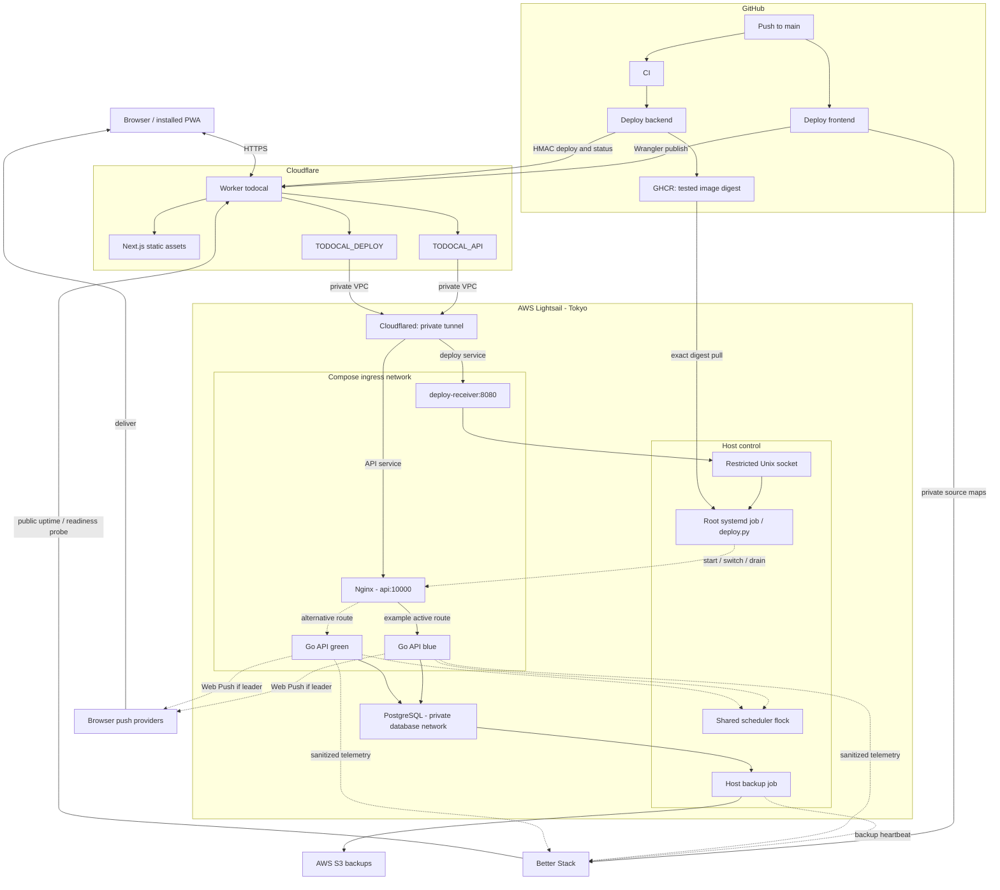

# TodoCal production deployment

Production: https://todocal.digitalhome.workers.dev. Local development uses the repository root Compose file, not the root-managed production Compose file on Lightsail.

## Architecture



AWS Lightsail (Tokyo, 2 GB RAM / 2 vCPU, owner-reported) runs PostgreSQL, Cloudflared, Nginx, one normally active API slot and a private deployment receiver. The API and DB have no published ports. During compatible releases the second slot warms, Nginx reloads gracefully, old workers drain, and the old API stops. Only one scheduler owns a shared local kernel lock. This is one host, not HA; host/database/proxy failures and incompatible migrations can cause downtime.

Blue is active only in this example; either slot can serve production. The two private VPC services share Cloudflared but target separate internal hostnames. Dashed edges include alternative routes and control/ownership or telemetry relationships, not additional active traffic paths.

See [end-to-end production flows](architecture.md) for request handling, CI/CD, signed events, Blue-Green handoff, migration, rollback, Web Push and backup/monitoring.

## Production configuration

| Location | Required configuration |
|---|---|
| GitHub repository secrets | DEPLOY_TRIGGER_SECRET |
| GitHub production environment or repository secrets | CLOUDFLARE_API_TOKEN, BETTER_STACK_API_TOKEN |
| GitHub variables | DEPLOY_VPC_SERVICE_ID (deployment receiver VPC UUID); LIGHTSAIL_EVENT_DEPLOY=false only to pause delivery |
| Worker runtime settings | API_BACKEND=vpc, PROXY_SECRET, DEPLOY_TRIGGER_SECRET |
| Worker bindings | TODOCAL_API (api:10000), TODOCAL_DEPLOY (deploy-receiver:8080), ASSETS |
| Lightsail api.env | DATABASE_URL (local production PostgreSQL), APP_ORIGIN (exact HTTPS frontend origin), PROXY_SECRET, VAPID_PUBLIC_KEY, VAPID_PRIVATE_KEY, VAPID_SUBJECT, monitoring/session settings |
| Lightsail host | root-owned secrets/trigger.key (same HMAC key as Worker and GitHub), backup.env, cloudflared.env, deployment tools, systemd socket, local scheduler lock, Blue-Green marker |

Keep tokens narrowly scoped; publishing Workers needs Workers Scripts permissions and account-level Connectivity Directory access for VPC bindings. Do not print secrets or full resolved Compose config. The Worker uses the exact private VPC service only; missing/invalid mode fails closed. Maintenance returns 503 on API requests, including GETs (which may mutate state); static assets remain available. Do not point back to the retired database.

## Releases and operations

- [Lightsail deployment and rollback](lightsail/README.md), [event delivery and fresh installation](lightsail/eventDeployment.md), [Blue-Green setup and recovery](lightsail/blueGreen.md).
- [Monitoring and source maps](monitoring.md).

Frontend deploys independently on main: locked dependencies, tests, build/typecheck, private source maps upload, configure deploy binding from DEPLOY_VPC_SERVICE_ID, Wrangler publication, website check. Do not deploy manually without both bindings: a bare Wrangler deploy can remove TODOCAL_DEPLOY. Set runtime secrets in the dashboard, verify both bindings after publishing, and avoid concurrent deployments.

Backend deploy runs after successful trusted main CI, publishes/reuses the tested image, and sends a signed event to the private receiver through the Worker. The host verifies the signature again and uses the exact digest under an exclusive deployment lock. Compatible updates use Blue-Green; changed/unknown migration fingerprints require digest-specific approval, maintenance and verified off-host backup. Pause delivery explicitly with LIGHTSAIL_EVENT_DEPLOY=false before host operations. Never bypass a persistent hold or restart both slots indiscriminately.

Frontend/backend releases are not atomic; use additive, backward-compatible changes, deploy backend first when a new frontend depends on it, and preserve compatibility with existing tabs. Use maintenance for incompatible changes.

Public GET /api/readyz confirms API/DB connectivity without exposing credentials or upstream internals. The proxy overwrites trusted client IP/secret headers, preserves cookies, Origin, CSRF and idempotency headers, never follows redirects, and marks API responses no-store. Keep Better Stack readiness and backup heartbeat monitoring independent.

## Embedded notification scheduler and verification

Go starts the embedded scheduler automatically; there is no separate worker, enable flag, jobs endpoint or Cloudflare Cron. Keep triggers.crons empty. A pre-created shared local kernel lock fences scheduler ownership during slot overlap; transaction-coupled PostgreSQL NOTIFY wakes the leader across slots. Relevant committed changes wake the next-deadline timer; retries use explicit backoff and the 15-minute reconciliation is a recovery mechanism. See [scheduler architecture](../docs/architecture/notificationScheduler.md). Missing VAPID disables delivery only, not Focus settlement.

Use dedicated test accounts to verify authentication, task CRUD, calendar/Focus, closed-tab push, quiet hours, recurrence and retry. Run CI, isolated database tests, local/public readiness and controlled authenticated smoke tests. On 2026-11-20 the first Blue-Green release succeeded (PR #51); owner reported a 200 response at each one-second probe. Sub-second gaps, authenticated in-flight requests, duplicate push behavior and manual rollback are not proved by those probes.

### Progress and query-cost verification

See [scheduler architecture](../docs/architecture/notificationScheduler.md) for runtime ownership, timeout decisions and tradeoffs.

Migration 000020 marks schedule changes with a transaction-local dirty flag.
The application publishes only after a dirty transaction commits. Read-only GETs
and planning cursor writes do not wake the coordinator; GETs that materialize
occurrences or settle Focus do. The flag rolls back with the mutation. Migration 000021 narrows task UPDATE
wakes to identity, scheduled date/start, deadline, status and deletion changes.
Title, description, priority, end time and revision-only edits do not change the
candidate schedule or generic push payload and do not publish a wake.

Horizon commits one recurring series (at most eight local dates) with a durable
`after_series` cursor per attempt. Retries/restarts retain completed batches;
mutations reset the cursor under the same account lock. The cycle timestamp is
pinned until its final page, so midnight cannot move the target while paging.
Accounts without eligible recurring task/deadline reminders have a NULL deadline;
preference, timezone and recurrence edits reactivate them when needed. Focus
settlement and on-demand calendar recurrence remain independent of this filter.
A single bounded batch can still time out during database unavailability; it is
retried without repeating previously committed series.

`NextDue` uses an EXISTS device check to avoid multiplying candidates by device
count. Its outbox lookup already has the unique `(subscription_id,event_key)`
index; retries use `notification_pending`. Migration 000020 adds an exact UTC
Focus deadline expression index, a completed-Focus time index and a partial
Task deadline index. These are not a substitute for measuring the global view.

Run the opt-in benchmark against a **dedicated disposable** database ending in
`_scheduler_bench_test` (it truncates users and dependent data). It tests 1k, 10k,
100k tasks with 100/1k/10k accounts and 1/5 devices per account. Each account has
a running Focus session, completed Focus history and a Horizon deadline; cleanup
is also scheduled. It calls the full `NotificationSchedule.Next()` under the
same two-second timeout used by the coordinator, captures its actual SQL for
EXPLAIN ANALYZE BUFFERS, and reports the first call plus mean/max warm latency.
Separate candidate and full-Next measurements help isolate query cost:

```sh
cd apps/api
SCHEDULER_BENCHMARK_DATABASE_URL='postgres://.../focus_scheduler_bench_test' \
  go test ./internal/services -run '^$' -bench '^BenchmarkNotificationSchedule$' \
  -benchtime=10x -count=1 -v
```

CI runs `bash scripts/benchmarkScheduler.sh` after integration tests and uploads
`scheduler-query-plans` with the EXPLAIN output and timings.

The integration suite also exercises one series with 100k historical occurrences
and 100k recurrence exceptions, including a negative deadline offset. Its first
Horizon batch must commit all eight new occurrences and its cursor within two
seconds; a fresh backend must finish the cycle on the next bounded call. This
checks large history, not arbitrary database slowness or lock contention. No
further Horizon architecture change is justified without measurements showing
that a bounded series exceeds the budget.

A PostgreSQL benchmark run shared during review passed at 100k tasks and five
devices per account: candidate mean 450.3 ms / maximum 512.0 ms, full
`NotificationSchedule.Next()` mean 438.9 ms / maximum 462.7 ms (10 iterations).
The shared EXPLAIN excerpt reported 475.0 ms execution time. These are local
benchmark observations, not a production latency guarantee or a load test.
The excerpt alone does not establish which indexes were used or migration cost.
Retain complete CI `scheduler-query-plans` artifacts for plan comparisons.

A passing deadline benchmark does not establish that the large-single-series
Horizon integration case passed; record that result separately. If measured
latency exceeds the budget, inspect the plans and lock contention before changing
timeouts or adopting a mutation-maintained deadline table. Reconciliation remains
a 15-minute recovery mechanism, not the notification timing path.
