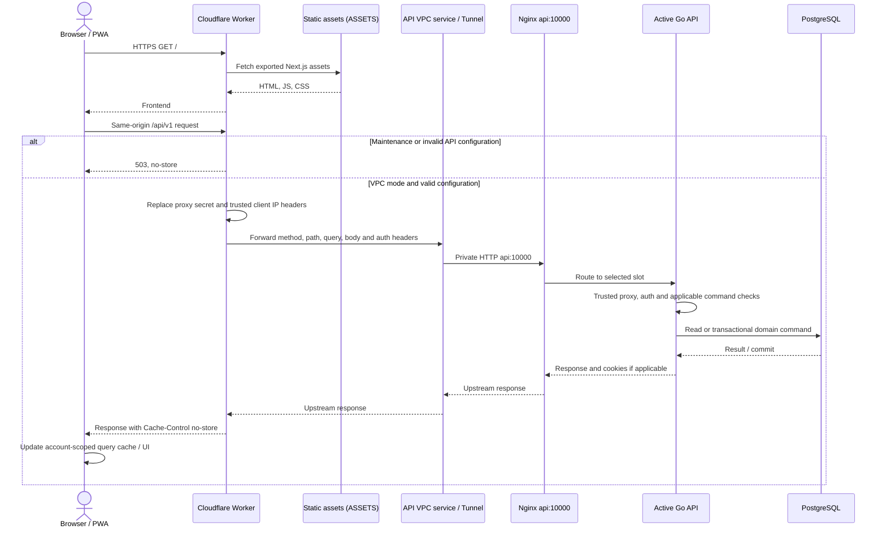
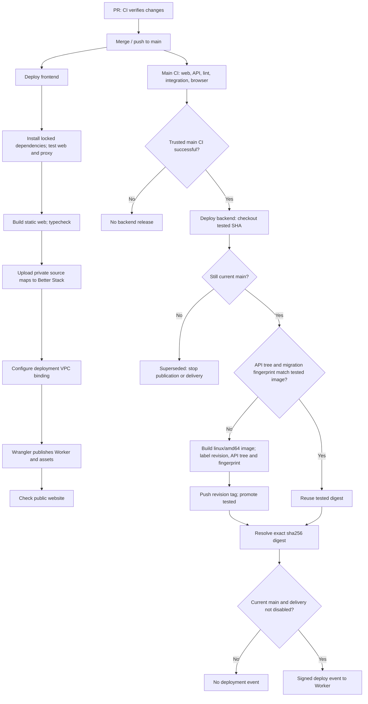
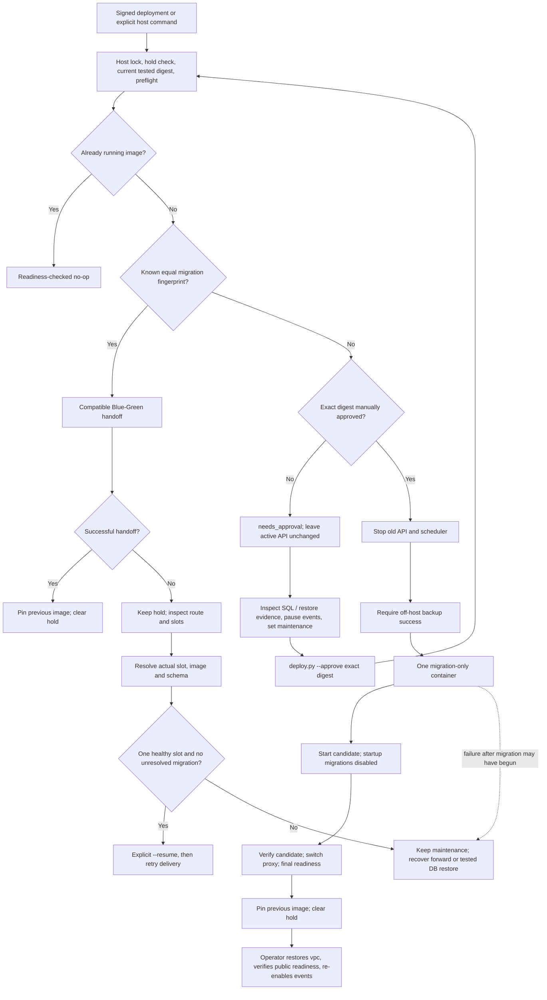
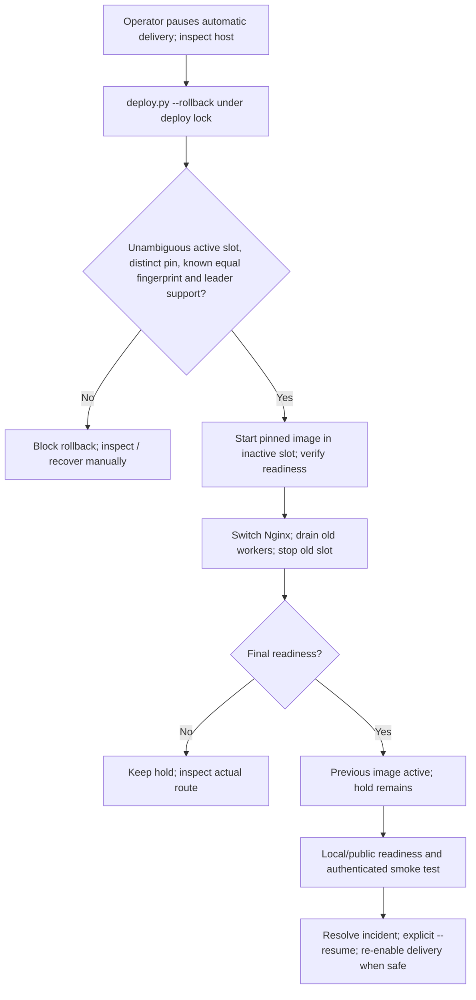
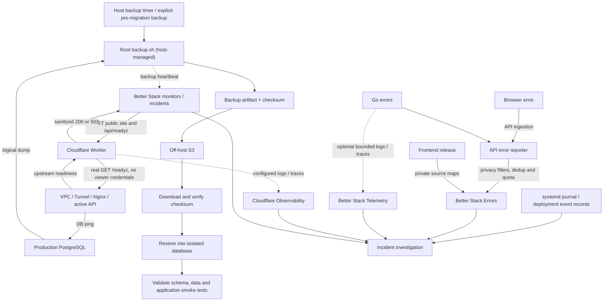

# Production architecture — end-to-end flows

Start with the [combined production topology](README.md#architecture).
This document describes the implementation and operator-reported installation,
not a proposal. Live host files, backup cadence and activated telemetry flags
have not been independently inspected. Blue is initially active in the examples;
the next compatible release reverses the slots.

## 1. Browser → frontend → API → database



1. Cloudflare serves exported Next.js assets directly, not a running Next.js Node server. Browser API calls use the same HTTPS origin.
2. The Worker routes the exact deploy and readiness paths separately. Normal API requests require API_BACKEND=vpc, PROXY_SECRET and TODOCAL_API. It removes Host, Forwarded and X-Forwarded-For, overwrites X-TodoCal-Proxy-Secret and X-TodoCal-Client-IP, and does not follow redirects.
3. Private VPC reaches Cloudflared and then Nginx on the ingress network. Nginx selects one Go slot using active.conf; no round-robin or automatic retry to the other slot.
4. Go owns authentication, authorization, Origin/CSRF/idempotency checks where applicable and domain transactions. Controllers call services and repositories. Both slots share PostgreSQL. Dirty schedule changes wake the scheduler after successful commit.
5. Browser state is not authoritative; the Service Worker neither caches private API responses nor queues offline writes.

Sources: [Worker](cloudflare/worker.mjs), [Nginx](lightsail/nginx.conf),
[Go router](../apps/api/internal/router/router.go),
[command pipeline](../docs/features/10-command-pipeline.md).

## 2. Commit → CI → independent frontend and backend releases



Frontend starts on main push or manual frontend dispatch, independently of
main CI. Its own tests, build/typecheck and source map upload gate publication.
Backend starts only after trusted successful main CI from this repository
(push or workflow_dispatch). The publisher revalidates main during publication;
superseded revisions stop. GHCR tested is a discovery pointer; the exact digest
is the deployment identity.

A docs-only main change may reuse the tested digest and still send an event.
If already running the verified image, the host performs a readiness-checked
no-op. LIGHTSAIL_EVENT_DEPLOY=false suppresses the event, not image publication;
unset means enabled under the workflow in this PR. The workflows independently
serialize their releases, without cancelling an in-flight deployment.
Frontend/backend rollout is not atomic; keep API changes backward compatible.

Sources: [CI](../.github/workflows/ci.yml),
[frontend](../.github/workflows/deployFrontend.yml),
[backend](../.github/workflows/deployBackend.yml), [publisher](lightsail/publish.sh).

## 3. Signed deployment → host admission → status

```mermaid
sequenceDiagram
    participant G as GitHub Actions triggerDeploy.py
    participant W as Worker deploy route
    participant V as Deploy VPC service / Tunnel
    participant R as Unprivileged receiver
    participant H as Root Unix socket gate
    participant J as Root systemd job / deploy.py
    participant E as Durable event record
    G->>G: Generate request ID and HMAC sign action/id/digest/ts
    G->>W: POST /api/internal/deploy
    W->>W: Require vpc mode; verify HMAC, size and timestamp
    W->>V: Private POST /deploy
    V->>R: deploy-receiver:8080
    R->>H: Bounded envelope via Unix socket
    H->>H: Verify HMAC and exact schema again
    H->>E: Check ID and digest under gate lock
    alt Existing ID with matching digest
        E-->>H: Existing status, no duplicate job
    else New deploy action
        H->>E: Atomically persist queued
        H->>J: Launch fixed unit without blocking
        J->>E: running
    end
    H-->>R: Status only
    R-->>V: Status only
    V-->>W: Status only
    W-->>G: Accepted status
    par Host job
        J->>J: Verify digest and execute release
        J->>E: Terminal status
    and Actions status polling
        loop Until terminal status or timeout
            G->>W: POST signed status with same ID
            W->>V: Forward verified message
            V->>R: Private receiver
            R->>H: Unix socket
            H->>E: Read matching record
            E-->>H: Current status
            H-->>R: Status
            R-->>V: Status
            V-->>W: Status
            W-->>G: Status
        end
    end
    alt succeeded
        G->>W: GET /api/readyz
        W-->>G: Require 200 and status ready
    else failed, needs_approval or timeout
        G->>G: Fail workflow; inspect host state
    end
```

The independent deployment HMAC secret is 64 lowercase hex characters used
as text. The signature covers the raw JSON bytes with action (deploy/status),
random 32-hex ID, exact SHA-256 image digest and Unix timestamp. The edge
bounds the request to 1024 bytes and 120 seconds of timestamp skew; root checks
signature, timestamp and exact schema again. Unsigned requests cannot start jobs.

Receiver UID/GID 10002 runs read-only, without Docker socket, DB credentials
or HMAC key. Its sole privileged interface is the restricted Unix socket.
Root writes a durable event record before launching the fixed systemd unit.
Matching replays report current status; a different digest for an existing ID
conflicts. Unknown status requests do not start jobs.

Actions checks status every 10 seconds for up to 45 minutes. The host retries
only lock contention (5 seconds, up to 10 minutes), not ordinary failures.
Cancelling Actions or losing HTTP does not cancel an admitted job. Job records
describe individual outcomes; the persistent hold fences unsafe future deploys.

Sources: [event runbook](lightsail/eventDeployment.md),
[edge gate](cloudflare/deployRoute.mjs), [receiver](lightsail/deployReceiver.py),
[root gate](lightsail/triggerHost.py), [CI client](lightsail/triggerDeploy.py).

## 4. Compatible backend update — Blue to Green

```mermaid
sequenceDiagram
    actor U as Browser requests
    participant J as Root deploy.py / blueGreen.py
    participant R as GHCR
    participant N as Nginx
    participant B as Blue (old)
    participant G as Green (candidate)
    participant L as Local scheduler flock
    participant D as PostgreSQL
    U->>N: Requests
    N->>B: Active traffic
    B->>L: Own scheduler lock
    J->>J: Exclusive deploy lock; reject unresolved hold
    J->>R: Resolve current tested digest
    J->>J: Verify requested digest and active slot / readiness
    alt Same verified image
        J->>J: Return success without restart
    else New compatible image
        J->>R: Pull exact digest and verify metadata
        J->>J: Recheck digest/slot, fingerprint and RAM
        J->>J: Write durable hold
        J->>G: Start candidate; skip startup migrations
        G->>D: Initialize API and check readiness
        G->>L: Standby tries lock; blue owns it
        U->>N: Requests still reach blue
        N->>B: Active traffic
        J->>G: Candidate ready (repeated probes)
        J->>N: Atomic active.conf, nginx -t, graceful reload
        U->>N: New requests
        N->>G: New active route
        Note over N,B: Old workers drain old requests
        J->>N: Verify green route, old workers gone and readiness
        J->>B: Stop old API
        B->>B: Cancel and drain scheduler lanes
        B-->>L: Release lock
        G->>L: Acquire lock and run scheduler
        G->>D: Recompute persisted work / listen for wakes
        J->>N: Verify final readiness
        J->>J: Pin previous image; clear hold; prune older API refs
    end
    Note over D: Same DB; no DB, tunnel or receiver restart
```

| Phase | Nginx route | Blue | Green | Scheduler |
|---|---|---|---|---|
| Steady | Blue | Running | Stopped | Blue |
| Warm-up | Blue | Running | Starting/ready | Blue |
| Reload/drain | Green for new requests | Running/draining | Running | Blue |
| Stop old | Green | Shutting down | Running | Blue until release |
| Steady | Green | Stopped | Running | Green after acquisition |

The candidate passes readiness before traffic changes. Nginx reload returns
before old workers exit; the deployer checks slot, worker PIDs and proxy
readiness before stopping the old API. Nginx has a 45-second worker shutdown
timeout, 35-second upstream read timeout and no automatic upstream retries.
Overlap requires at least 640 MiB MemAvailable; the example caps each API at
512 MiB. A candidate can serve requests before owning the scheduler lock:
these handoffs are distinct. The relative timing of final readiness and
scheduler acquisition is not guaranteed; readiness does not check leadership.

Forward success pins the outgoing image as todocal-api:bluegreen-rollback,
not the mutable inactive slot tag. Failure before switch stops the compatible
candidate and leaves the old route; ambiguous switch/drain keeps both slots
and the hold for inspection. Never blindly restart or stop either slot.

Sources: [implementation](lightsail/blueGreen.py), [runbook](lightsail/blueGreen.md).

## 5. Migration approval, rollback and recovery



Fingerprint covers migrations, migrate.go, start.sh, go.mod and go.sum.
Unknown or different fingerprint requires human approval even when SQL is
unchanged. Approval is bound to the current tested digest. Pause delivery,
fence writes in maintenance, verify recovery and review SQL first. The host
stops the old API, takes an off-host backup, runs one explicit migration and
starts the new API. Do not automatically restart the old binary after migration
may have started. This path entails downtime.



Manual rollback uses only the dedicated compatible pin and does not repin
the outgoing, possibly unhealthy image. An unhealthy but identifiable running
active slot can be rolled back without initial readiness. Missing pin,
incompatible fingerprint, ambiguous active slot or already active pin blocks
rollback. Successful rollback leaves the hold. Never clear hold.json by hand;
--resume preflight is not proof of safe data semantics. Resolve migration
uncertainty first. See [operations](lightsail/README.md) and [recovery](lightsail/blueGreen.md).

## 6. Scheduled work → Web Push (including slot overlap)

```mermaid
sequenceDiagram
    actor U as User / device
    participant A as API serving request
    participant D as PostgreSQL
    participant S as Scheduler leader (may be other slot)
    participant P as Browser push provider
    participant W as Service Worker
    U->>A: Explicit opt-in / task or Focus mutation
    A->>D: Store consent or domain changes
    A->>D: If schedule dirty, NOTIFY in same transaction
    D-->>A: Successful commit
    A->>A: Local coalesced wake
    A-->>U: Command result
    D-->>S: LISTEN/NOTIFY after commit
    S->>D: Query persisted next deadline
    S->>S: Arm next timer; 15-minute recovery reconciliation
    S->>D: Run bounded due lane; persist outbox / progress
    S->>D: Revalidate event, subscription, preferences and quiet hours
    alt Eligible notification and valid VAPID
        S->>P: HTTPS Web Push
        P-->>S: Acceptance or provider failure
        S->>D: Record sent, retry date or terminal outcome
        opt Provider delivers push
            P-->>W: Push event
            W-->>U: Generic notification with stable tag
            U->>W: Click notification
            W->>U: Navigate to same-origin Calendar / Focus
        end
    else No eligible delivery
        S->>D: Settle state / cancel stale event as applicable
    end
```

Both slots share the same pre-created read-only mounted lock inode. Only the
kernel lock owner executes the four lanes: Focus settlement, dispatch, recurrence
horizon and terminal outbox cleanup. Standby probes locally every 200 ms;
DB disconnect does not release the lock. The leader queries persisted due work
and listens on a dedicated connection; reconnect wakes it. Local coalesced
wakes and 15-minute reconciliation complement transactional NOTIFY.

Push does not require an open tab; actual delivery still depends on OS/browser
and provider. Outbox is durable per device/event. Transient failures retry at
persisted times, stale subscriptions are revoked when appropriate. Stable tags
reduce duplicate display, but provider acceptance followed by a crash before
commit remains at-least-once. See [scheduler architecture](../docs/architecture/notificationScheduler.md),
[notification contract](../docs/features/12-pwa-notifications.md),
[host leader](../apps/api/internal/workers/hostLeader.go),
[transaction wake](../apps/api/internal/database/scheduleWake.go).

## 7. Backup, recovery and observability



Backup script/timers and S3 are host-managed, not generated by this repository.
The deployer explicitly calls backup.sh frequent before an approved incompatible
migration. Verify cadence, upload, checksum and isolated restore on the host.
A successful heartbeat alone is not recovery evidence. Never restore a rehearsal
into the production volume.

Public readiness requires vpc mode, a valid proxy-secret configuration and the
binding, then performs a real GET /readyz through the active slot; HEAD performs
the same probe without a body. The Worker returns minimal 200/503 without viewer
credentials, upstream headers or cached results. It checks API/DB connectivity,
not business state, scheduler progress, push delivery or backup freshness.
Keep website, readiness and heartbeat signals separate.

Browser errors enter the API; the reporter sanitizes data and applies
deduplication, rate limits and a shared durable budget. Optional Go diagnostic
log and trace exports are separately configurable, not assumed enabled.
Correlate safe request IDs and release metadata with container logs and the host
journal, without logging credentials or private user data.
See [monitoring](monitoring.md) and [error contract](../docs/features/11-monitoring.md).

## Operational boundaries

- Single-host Blue-Green improves compatible release continuity, not infrastructure HA.
- Public HTTPS, two private VPC services, unprivileged receiver, restricted Unix socket, root deployment and private DB are distinct trust boundaries.
- Active API slot, scheduler leader, GHCR tested digest and rollback pin are different state variables.
- First forward rollout succeeded on 2026-11-20; the owner reported HTTP 200 at every one-second probe. This does not establish sub-second continuity, no duplicate provider calls, manual rollback or backup restore.
- Use the [operational runbooks](README.md#releases-and-operations), not diagrams alone, for host changes.
