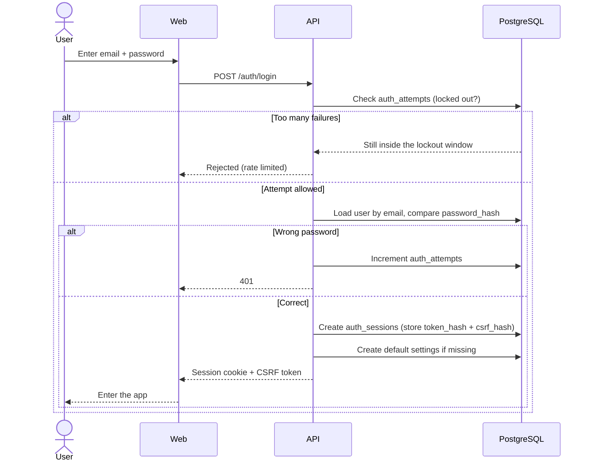
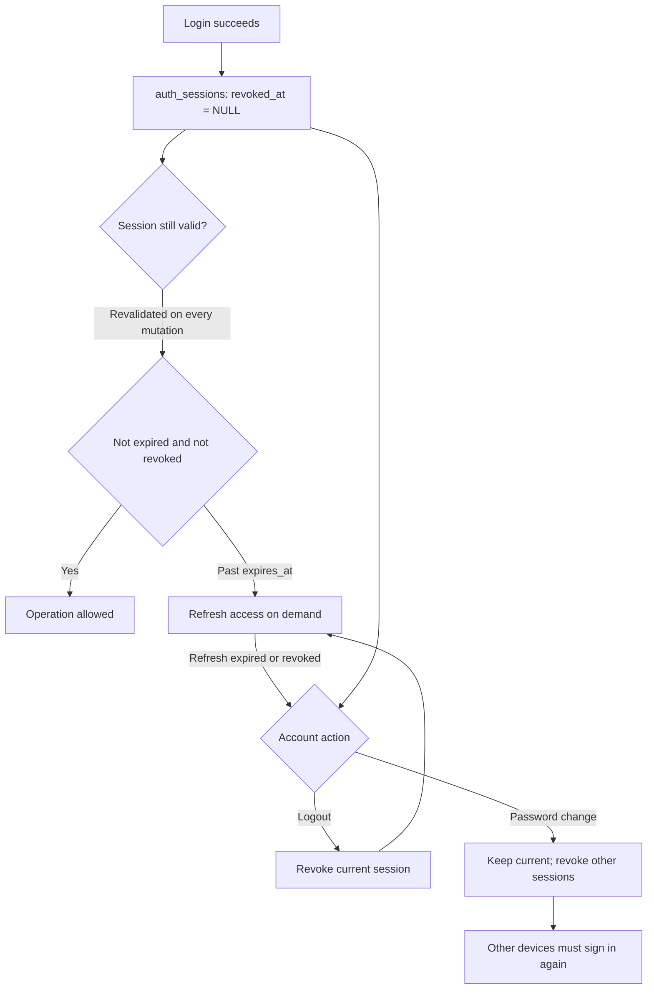

# 01 — Accounts & Authentication

## Purpose

Registration, login, logout, password changes, and personal settings (time zone, appearance, Pomodoro defaults). All of a user's data is isolated by `user_id` in every table.

## Data

| Table | Role |
|-------|------|
| `users` | Account: `id`, `email` (unique), `password_hash`, `created_at` |
| `settings` | One row per user: `timezone` (default `UTC`), `appearance` light/dark, `focus_minutes` 25, `short_break_minutes` 5, `long_break_minutes` 15, `sound`, `revision` |
| `auth_sessions` | Login sessions: `token_hash`, `csrf_hash`, `expires_at`, `revoked_at` |
| `auth_attempts` | Counts failed login attempts per key to throttle brute force |

## Key rules

- Passwords are stored only as hashes; session and CSRF tokens are also stored only as hashes (`token_hash`, `csrf_hash`).
- Logout revokes the **current** session by setting `revoked_at`. Password change revokes **other sessions** but keeps the session performing the change valid. Revoked sessions cannot be used on subsequent authenticated requests.
- Every write request **revalidates the session inside its transaction** (`ValidateOwnedSession` in `Execute`), so revocation takes effect instantly.
- `settings.revision` follows the same optimistic-concurrency rule as every other entity: a wrong `expectedRevision` returns 409.

## Login flow

## Session lifecycle

## Session and device behavior

- Login creates a one-hour access cookie and a rotating refresh cookie with a 30-day inactivity expiry. Each successful refresh starts a new 30-day window; there is no absolute maximum lifetime. Signing in on another device creates a separate session family. Credentials are HttpOnly cookies; only hashes are stored server-side.
- Logout terminates only the current session. Changing a password invalidates the other sessions and leaves the current session valid.
- `Execute` rechecks ownership and session validity under the write transaction. Read endpoints are authenticated before `View`; do not treat this as a fresh session check *inside* every read transaction.
- The browser must clear account-owned cached query data on logout/account switch. A cached browser view or installed PWA must not treat an expired cookie as proof of authentication.
- When access expires, the browser renews it on demand and retries only a rejected authentication/CSRF request, retaining its idempotency key and account guard. Refresh expiry/revocation requires sign-in. Credential-changing requests share a Web Lock across tabs, with a local queue fallback. Refresh reuse outside a fixed 30-second concurrency/lost-response grace revokes the family.

See [settings](13-settings.md) for account preferences and [PWA/notifications](12-pwa-notifications.md) for device-local permissions.

### Upgrade behavior
Existing pre-refresh sessions retain their original expiry. Signing in again issues the new credential pair. `focus_device` is a persistent, non-authenticating browser identifier: a successful login reattaches that account's still-authorized push subscriptions to the new family. It never restores consent after logout or notification revocation.
