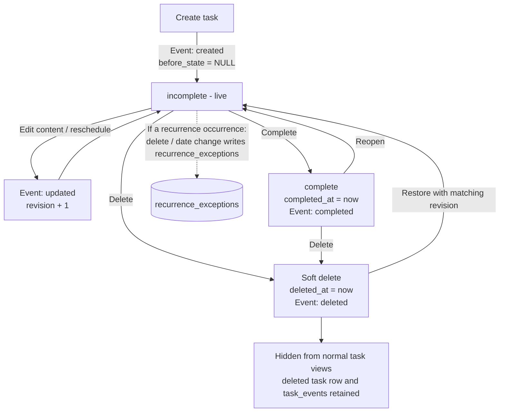
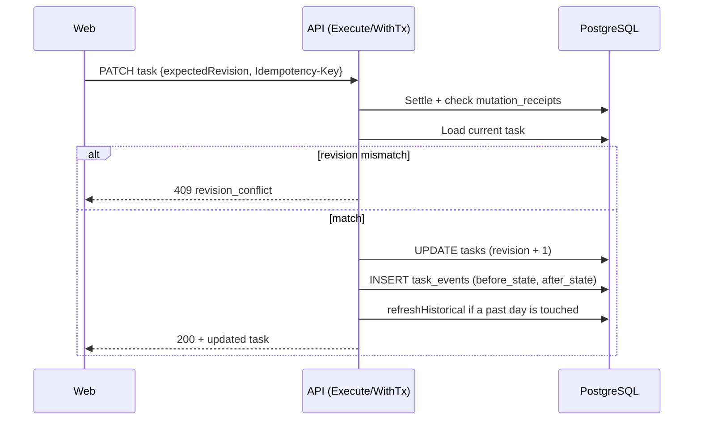

# 02 — Task Management

## Purpose

Create, edit, complete, reopen, delete, and restore tasks. The task is the central entity: the calendar, recurrence, Pomodoro, and analytics all hang off it.

## Data

| Table | Role |
|-------|------|
| `tasks` | The live row of a task: title, description, group_id, priority, scheduled_date, start_time/end_time, deadline, status, estimated_pomodoros, focus_minutes, completed_at, `deleted_at` (soft delete), series_id/original_occurrence_date (for recurrence occurrences), `revision` |
| `task_events` | Immutable journal: one row per change, with `before_state`/`after_state` holding the **entire task JSON** before/after (not a diff) |

The fields `actualFocusSeconds`, `focusProgress`, `recurrenceCadence`, and `recurrenceIntervalDays` in returned JSON are **not columns** — they are computed at query time from `focus_sessions` and `recurrence_series`.

## Key rules

- Validation: title must be 1–300 characters; times must come as a start/end pair, belong to a scheduled date, satisfy `end > start`, and the local time must actually *exist* in the user's time zone (blocks times falling into a DST gap).
- Every edit/delete/complete sends `expectedRevision`; a mismatch returns 409 `revision_conflict` instead of blindly overwriting.
- Delete is a **soft delete** (`deleted_at = now`, revision + 1). The frontend offers a short-lived **Undo toast** (currently 10 seconds); this is a UI visibility period, **not** an API-enforced restore expiry. The backend restore endpoint currently accepts a deleted task with a matching `expectedRevision` even after the toast disappears.
- Completing sets `completed_at`; reopening clears it. The completion date can be edited manually, and superseded `completed` events are invalidated (`task_events.invalidated_at`) so the completion day is never double-counted.
- Every change goes through `Event(...)`: it appends to `task_events` and, if the change touches a past day, updates that day's snapshot via `refreshHistorical` (see doc 07).

## Task lifecycle

## One edit command (condensed)

## Deletion, recovery, and completion semantics

- A soft-deleted row remains in `tasks` for recovery and historical identity; it is not physically purged when the toast expires. Any future retention/expiry policy must be specified and enforced by the API before the documentation can promise one.
- Restoring recovers the task's prior content/status (including a completed status) and creates another journal event. Re-check revisions to avoid restoring over intervening changes.
- A manually specified `completedAt` may attribute completion to a different date. The journal and affected daily snapshots must be reconciled once; do not count superseded completion events twice.
- Task completion is independent of the Pomodoro goal: hitting a planned number of sessions never silently marks a task complete.
- User-initiated backdated edits can intentionally adjust finalized history. This exception is auditable and distinct from automatic rescheduling or group cleanup; see [day finalization](07-planning-finalization.md).
- **Proposed recurring deletion UX (not yet implemented):** ask **This occurrence** or **This and following**. The latter cancels the selected original slot and all future slots, while retaining task/Focus audit records; see [implementation backlog](16-implementation-backlog.md).
