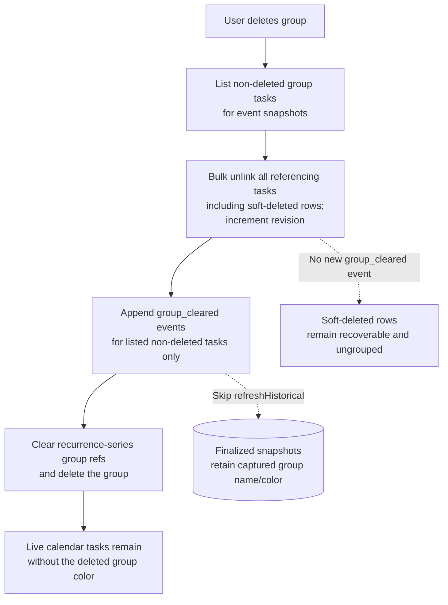

# 03 — Groups

## Purpose

Classify tasks into named, colored groups — the group color is the border color of the task's calendar event, and group is one of the toolbar filter dimensions.

## Data

| Table/column | Role |
|--------------|------|
| `groups` | `name` (1–100 characters), `color` in `#RRGGBB` form, `revision`; primary key `(user_id, id)` |
| `tasks.group_id` | FK `(user_id, group_id)` → `groups`; `NULL` means no group |

## Key rules

- Name and color are validated both in the database (CHECK constraints) and in the service layer.
- Deleting a group **does not delete its tasks**. `UnlinkGroupTasks` clears `group_id` and increments `revision` for **every task still referencing the group**, including soft-deleted rows (`deleted_at IS NOT NULL`).
- **Only non-deleted tasks are journaled for this operation:** `ListGroupTasks` filters `deleted_at IS NULL`, and the service appends a `task_events` record with `kind = 'group_cleared'` for each task returned by that query. **Soft-deleted tasks are ungrouped and revisioned but receive no new `group_cleared` event**; their earlier event history remains stored.
- The `group_cleared` event deliberately skips `refreshHistorical`. Group deletion does **not** change finalized-day snapshots, their captured group name/color, or planned/completed totals. Associated recurrence-series group references are cleared as well.
- Renaming/recoloring a group also uses optimistic concurrency (`expectedRevision`).

## Delete-group flow

## Historical display policy

- Live tasks immediately lose the deleted group's border color. A finalized-day entry may still show the historical group color/name captured in `daily_plan_entries.task_state`.
- A later **explicit** edit to a task in a finalized day may adjust that entry; group deletion alone never silently rewrites the snapshot. See [historical adjustments](07-planning-finalization.md).
- **Audit and recovery expectation:** non-deleted affected tasks have a `group_cleared` event; soft-deleted affected tasks have an incremented revision and `group_id = NULL` **without** that new event. Restoring such a task requires its latest revision and restores it **without** the deleted group. An ordinary `restored` event is written by the restore path. Previously recorded events remain available.
