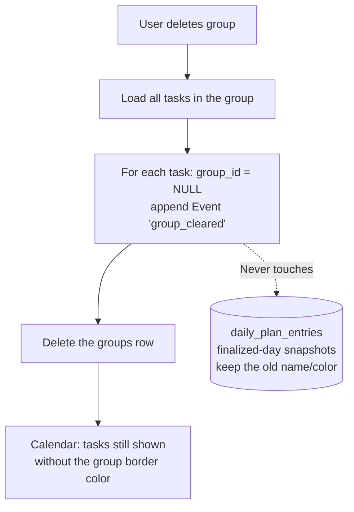

# 03 — Groups

## Purpose

Classify tasks into named, colored groups — the group color is the border color of the task's calendar event, and group is one of the toolbar filter dimensions.

## Data

| Table/column | Role |
|--------------|------|
| `groups` | `name` (1–100 characters), `color` in `#RRGGBB` form, `revision`; primary key `(user_id, id)` |
| `tasks.group_id` | FK `(user_id, group_id)` → `groups`; `NULL` means no group |

## Key rules

- Name and color are validated both in the database (CHECK constraints) and in the service layer.
- Deleting a group **does not delete its tasks**: each affected task is ungrouped (`group_id = NULL`) and gets its own event with `kind = 'group_cleared'`. This event is special: it does *not* trigger `refreshHistorical`, because ungrouping must not rewrite finalized-day statistics — old snapshots keep the group name/color as of finalization time (stored inside `daily_plan_entries.task_state`).
- Renaming/recoloring a group also uses optimistic concurrency (`expectedRevision`).

## Delete-group flow

