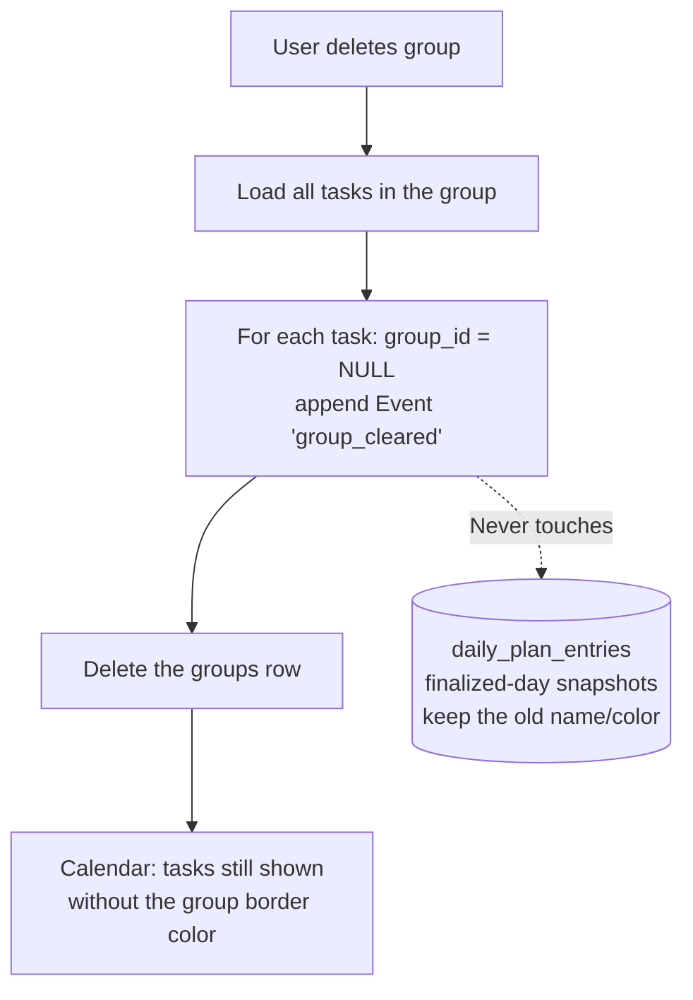

# 03 — Groups

## Purpose

Classify tasks into named, colored groups — the group color is the border color of the task's calendar event, and group is one of the toolbar filter dimensions.

## Data

| Table/column | Role |
|--------------|------|
| `groups` | `name` (1–100 characters), `color` in `#RRGGBB` form, `revision`; primary key `(user_id, id)` |
| `tasks.group_id` | FK `(user_id, group_id)` → `groups`; `NULL` means no group |

## Key rules

- Name and color are validated both in the database (CHECK constraints) and in the service layer.
- Deleting a group **does not delete its tasks**: each affected task (including soft-deleted rows that still reference the group) is ungrouped (`group_id = NULL`), revisioned, and journaled with `kind = 'group_cleared'`. That event deliberately skips `refreshHistorical`; old finalized entries preserve their captured group name/color. Group removal does not change their planned/completed totals.
- Renaming/recoloring a group also uses optimistic concurrency (`expectedRevision`).

## Delete-group flow

## Historical display policy

- Live tasks immediately lose the deleted group's border color. A finalized-day entry may still show the historical group color/name captured in `daily_plan_entries.task_state`.
- A later **explicit** edit to a task in a finalized day may adjust that entry; group deletion alone never silently rewrites the snapshot. See [historical adjustments](07-planning-finalization.md).
