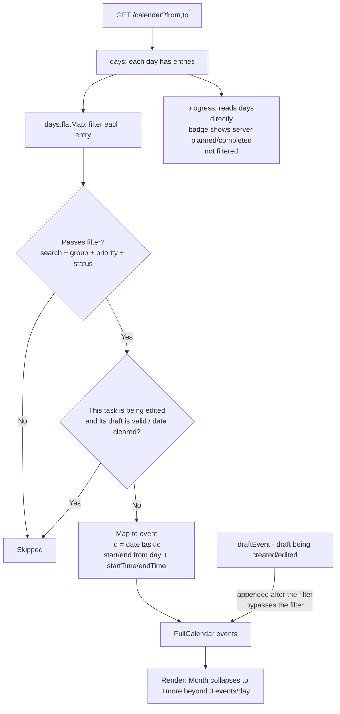
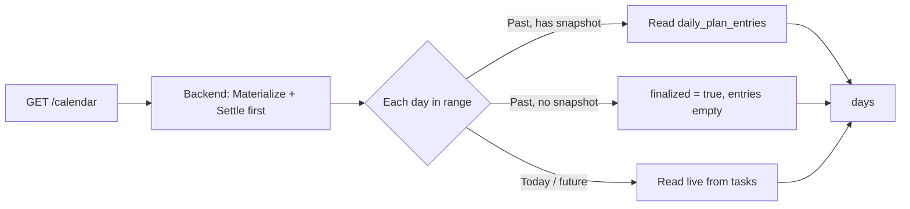

# 04 — Calendar & Display

## Purpose

Show scheduled tasks in Day / Week / Month views (FullCalendar), with a search/filter toolbar, a per-day progress badge, and the unscheduled "Without a date" section.

## Data sources

- The calendar calls `GET /calendar?from=&to=` for the visible range (backend limits ranges to 1–93 days; `to` is exclusive). The response carries `days` (each with entries plus planned/completed/percentage and `finalized`) — the frontend builds events from `days` and does not use the response's `tasks` field.
- The "Without a date" section separately calls `GET /tasks?view=unscheduled&limit=20`.

## Display pipeline (frontend, `calendar.tsx`)

## Rules & notes

- This is the **only path** by which a persisted task reaches the calendar grid. `eventContent` is only a renderer for events already in the array, not a second data source.
- **The draft preview is a deliberate exception**: the task being created/edited is appended afterwards (`[...events, preview]`) so it shows even when it does not match the filter; its original is hidden from the filtered list at the same time to avoid showing it twice.
- The day progress badge (`progress()`) reads the server numbers in `days` and is **not filtered** — with a filter active, the badge can count more tasks than are visible. (Whether the badge should follow the filter is a pending product decision.)
- A `finalized` day only adds the `event-historical` CSS class (solid border) — it never hides events.
- The day-detail panel (clicking a day) lists that day's `entries` **without** the filter; the "Without a date" section does reuse the same `filter()`.

## Data flow by day type

