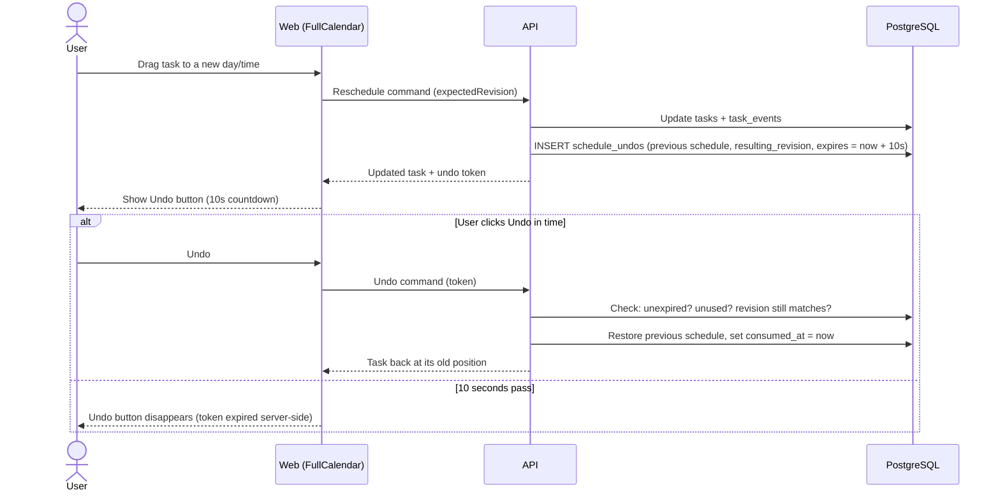

# 05 — Drag-and-Drop Scheduling & Schedule Undo

## Purpose

Drag a task to another day/time or resize it directly on the calendar, and undo the change within 10 seconds — with the deadline enforced by the server.

## Data

| Table | Role |
|-------|------|
| `schedule_undos` | Undo token: `task_id`, the previous schedule (`previous_date`, `previous_start`, `previous_end`), `resulting_revision` (the task's revision right after the move), `expires_at`, `consumed_at` |

## Key rules

- A reschedule is an ordinary mutation: it goes through the command pipeline (doc 10) and appends a `task_events` row of kind `updated`; if the task is a recurrence occurrence that changed day, it also writes a `recurrence_exceptions` row with reason `moved` (doc 06); if it moves into or out of a past day, `refreshHistorical` updates the snapshots on both sides (doc 07).
- The server, not the client clock, owns the undo deadline (10 seconds from the token's `created_at` to `expires_at`).
- Undo is valid only when: the token is unexpired, unused (`consumed_at IS NULL`), and the task's current revision still equals `resulting_revision` — if the task was edited again after the move, undo is refused rather than overwriting the newer change.

## Flow

