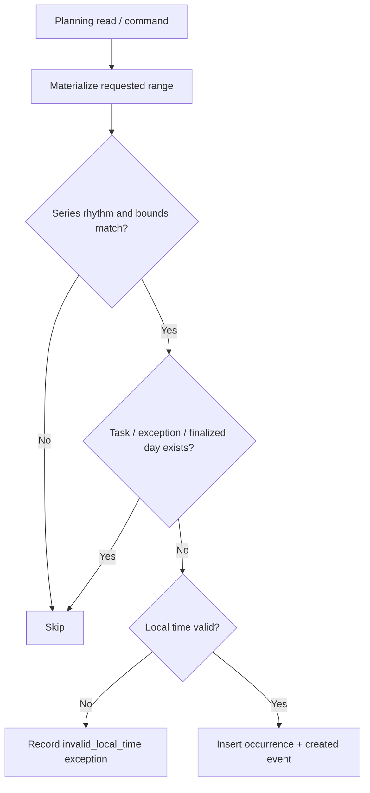
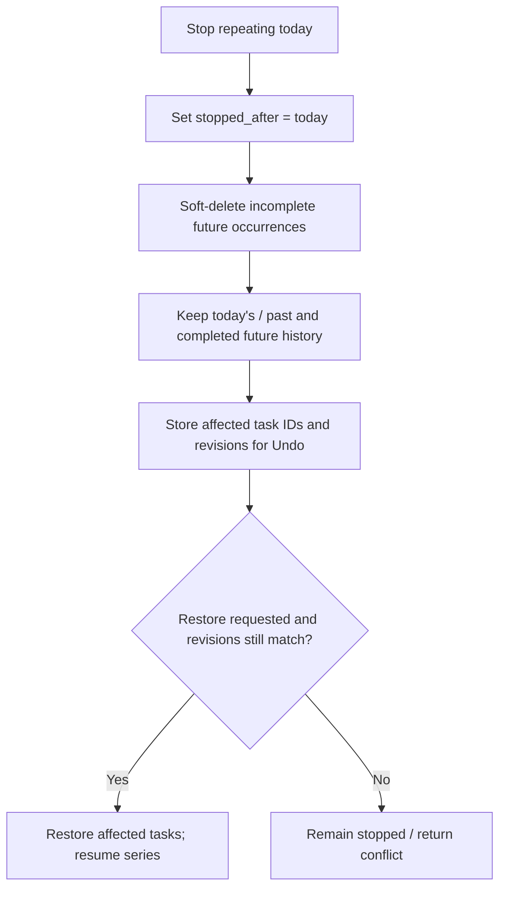

# 06 — Recurrence

## Purpose

Repeat tasks daily, every N days, or weekly without eagerly creating an infinite future. A series stores a template; each materialized occurrence is a normal task with its own ID, completion state, focus history, and revision.

## Data

| Table / field | Role |
|---|---|
| `recurrence_series` | Template, start date, cadence/interval, inclusive end date, `stopped_after`, exclusive `original_cutoff`, `schedule_offset_days`, deadline offsets, `revision` and `stop_undo` |
| `tasks.series_id` + `tasks.original_occurrence_date` | Stable identity of a materialized slot even when its scheduled date moves; unique as a pair |
| `recurrence_exceptions` | Original-slot suppression for `deleted`, `moved`, `rule_excluded`, and `invalid_local_time` |

## Lazy materialization

`Materialize` runs during planning reads/commands for bounded date ranges (up to 93 days). A slot is skipped when the original (series, occurrence date) already exists (even soft-deleted), an exception seals it, or the date is already finalized. Newly created historical series are an explicit exception to the finalized-day guard.

`schedule_offset_days` shifts the *effective* scheduled day while preserving the original identity and cadence anchor. A recurring slot with an invalid local wall-clock time is skipped and recorded as `invalid_local_time`.

`deleted` and `moved` are durable user-intent exceptions; an `invalid_local_time` exception is **recomputable** for future slots after a timezone/series change. It must not be described as permanent under every circumstance.

## Editing scope

**This occurrence** edits one task while retaining its series and original slot. Moving it records a durable moved exception, so its old slot is never regenerated.

**This and following** starts at the selected immutable original slot, inclusive. The old series receives an exclusive `original_cutoff`; a new tail series owns the existing task IDs and exceptions from that slot onward. Earlier slots stay unchanged. The UI can change the tail cadence, interval, end date and task fields. Schedule offsets preserve original slot identity even for moved occurrences. The editor sends only changed task fields for this scope, so omitted fields retain each sibling’s own overrides. Explicitly edited fields replace those values in eligible siblings. Every membership change increments the task revision and journals `series_reparented` before/after states, including protected and deleted tasks; this metadata-only event leaves historical snapshots unchanged.

Completed, Focus-history-bearing, historical and finalized tasks retain their content. A completed or focused selected occurrence can only be edited individually. Explicitly deleted slots remain deleted; moved exceptions survive cadence changes. Future invalid-wall-time predictions are cleared and recomputed under the new template. Off-cadence eligible tasks are soft-deleted with a distinct `rule_excluded` exception when cadence/end date changes. If a later rule includes that slot, an eligible task is restored with the same ID and scheduled at its original slot plus the current accumulated schedule offset. This normalization does not create a moved exception, so later cadence changes can exclude the slot again; an explicit user deletion remains deleted. Completed, focused, historical and finalized tasks are not automatically restored. Tail edits cannot move repetitions into the past.

The legacy `all` API scope remains compatible with older clients and edits eligible materialized occurrences from today forward. New UI actions use `following`; these scopes are intentionally distinct.

## Delete this and following

The selected original slot is the inclusive cutoff. Eligible current/future tasks in that tail are soft-deleted, and unmaterialized slots are suppressed. Earlier, historical and finalized tasks remain unchanged. Completed future tasks require explicit confirmation; their completion and Focus history remain stored. This does not add a Trash screen.

Undo stores the prior cutoff plus each deleted task revision. Restore checks the series and all affected task revisions atomically; conflicts restore nothing. Repeated commands use the existing idempotency receipts. The UI Undo toast lasts ten seconds; the backend restore is revision-based, not time-expiring.

## Stopping and restoring a series

The legacy API `Stop` starts from **today**, not an arbitrary selected day X:

1. Set `stopped_after` to today so future unmaterialized slots cannot appear.
2. Soft-delete eligible **incomplete** future materialized occurrences (today's occurrence and past history remain; completed future occurrences are not soft-deleted by this operation).
3. Save affected task IDs plus post-delete revisions in `stop_undo`.
4. Backend `RestoreStop` checks the series revision and every affected task revision before restoring them atomically and clearing `stopped_after`.

The current backend restore does **not** enforce a 10-second expiry; the UI toast does. Do not confuse this with the server-enforced [schedule undo](05-schedule-undo.md).

## Acceptance checks

- Reloading the same date range never generates duplicate slots, including moved or soft-deleted originals.
- Editing just one occurrence does not silently rewrite its siblings; moving it does not regenerate its old slot.
- Editing **This and following** changes only the selected original slot and tail, preserves IDs/exceptions/history, and applies changed cadence to lazy future materialization.
- Deleting **This and following** hides eligible tail tasks and suppresses lazy regeneration; Undo is atomic and conflicting revisions prevent partial restoration.
- Stop preserves prior history and completed future occurrences; a conflicting revision prevents partial restore.
- A timezone change can cause **future** invalid-wall-time exceptions to be recalculated without resurrecting explicit deletions.
- Recurrence uses local calendar dates and inclusive end-date semantics across daylight-saving changes.

See [day finalization](07-planning-finalization.md), [schedule undo](05-schedule-undo.md), and [acceptance tests](15-acceptance-scenarios.md).
