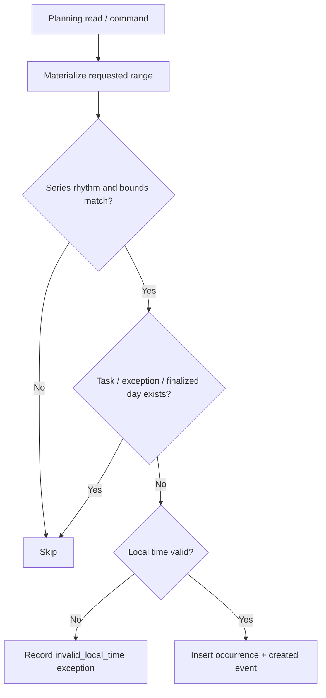
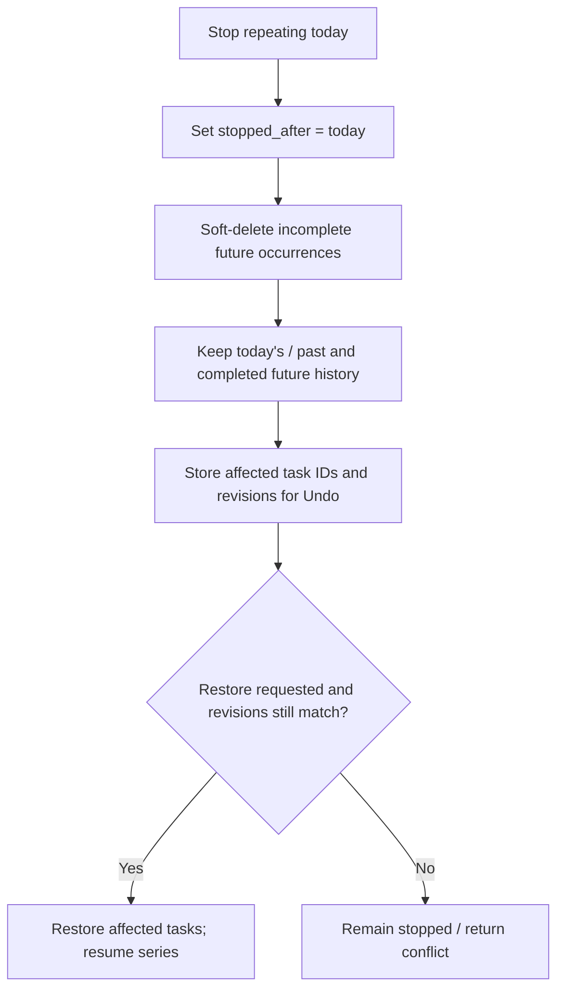

# 06 — Recurrence

## Purpose

Repeat tasks daily, every N days, or weekly without eagerly creating an infinite future. A series stores a template; each materialized occurrence is a normal task with its own ID, completion state, focus history, and revision.

## Data

| Table / field | Role |
|---|---|
| `recurrence_series` | Template, start date, cadence/interval, inclusive end date, `stopped_after`, `schedule_offset_days`, deadline offsets, `revision` and `stop_undo` |
| `tasks.series_id` + `tasks.original_occurrence_date` | Stable identity of a materialized slot even when its scheduled date moves; unique as a pair |
| `recurrence_exceptions` | Original-slot suppression for `deleted`, `moved`, and `invalid_local_time` |

## Lazy materialization

`Materialize` runs during planning reads/commands for bounded date ranges (up to 93 days). A slot is skipped when the original (series, occurrence date) already exists (even soft-deleted), an exception seals it, or the date is already finalized. Newly created historical series are an explicit exception to the finalized-day guard.

`schedule_offset_days` shifts the *effective* scheduled day while preserving the original identity and cadence anchor. A recurring slot with an invalid local wall-clock time is skipped and recorded as `invalid_local_time`.

`deleted` and `moved` are durable user-intent exceptions; an `invalid_local_time` exception is **recomputable** for future slots after a timezone/series change. It must not be described as permanent under every circumstance.

## Editing scope: actual current behavior

**This occurrence**: an ordinary task edit. The occurrence **remains attached to its series**; its own fields can differ from the template. A date move retains `series_id` and `original_occurrence_date` and writes a `moved` exception for the old slot. It is **not automatically detached** into a standalone task.

**All occurrences**: a series-aware edit that updates the template and eligible **materialized occurrences from today forward**, not just occurrences after the selected date. The series keeps the same ID; a schedule move changes `schedule_offset_days`. It does **not** split the old series and create a new one.

The UI wording must match this scope: **All occurrences from today onward** (not **This and following**). Historical occurrences remain unchanged, and explicitly deleted/materialized exceptions retain their identity. Updates can fail atomically if an affected occurrence would become invalid in its timezone.

**Approved proposed UX (not implemented):** replace the ambiguous current series-wide option with **This and following** for both **Edit** and **Delete**. The scope starts at the selected occurrence's **original slot**, inclusive—not today's date. Edits split the old series at that slot and create a new tail series; deletion stops the old series at that slot without recreating the tail. Past occurrences stay unchanged; preserve task IDs, completion/Focus history, revisions, moved/deleted exceptions and snapshots without duplicates. Do not silently change completed future occurrences during an edit. See the detailed migration/validation plan in [implementation backlog](16-implementation-backlog.md#gap-02--03--recurrence-edit-and-delete-this-and-following).

## Stopping and restoring a series

Current `Stop` starts from **today**, not an arbitrary selected day X:

1. Set `stopped_after` to today so future unmaterialized slots cannot appear.
2. Soft-delete eligible **incomplete** future materialized occurrences (today's occurrence and past history remain; completed future occurrences are not soft-deleted by this operation).
3. Save affected task IDs plus post-delete revisions in `stop_undo`.
4. UI offers a short-lived **Undo** toast. Backend `RestoreStop` checks the series revision and every affected task revision before restoring them atomically and clearing `stopped_after`.

The current backend restore does **not** enforce a 10-second expiry; the UI toast does. Do not confuse this with the server-enforced [schedule undo](05-schedule-undo.md).

## Acceptance checks

- Reloading the same date range never generates duplicate slots, including moved or soft-deleted originals.
- Editing just one occurrence does not silently rewrite its siblings; moving it does not regenerate its old slot.
- Until the proposed change ships, an `all` edit from a future selected occurrence changes eligible occurrences from **today**, not just the selected date.
- **Proposed tests, not passing-current-contract:** Edit *This and following* changes only slots at/after the selected original occurrence; Delete *This and following* removes the same tail from active calendar views while retaining audit and Focus history. See [backlog](16-implementation-backlog.md).
- Stop preserves prior history and completed future occurrences; a conflicting revision prevents partial restore.
- A timezone change can cause **future** invalid-wall-time exceptions to be recalculated without resurrecting explicit deletions.
- Recurrence uses local calendar dates and inclusive end-date semantics across daylight-saving changes.

See [day finalization](07-planning-finalization.md), [schedule undo](05-schedule-undo.md), and [acceptance tests](15-acceptance-scenarios.md).
