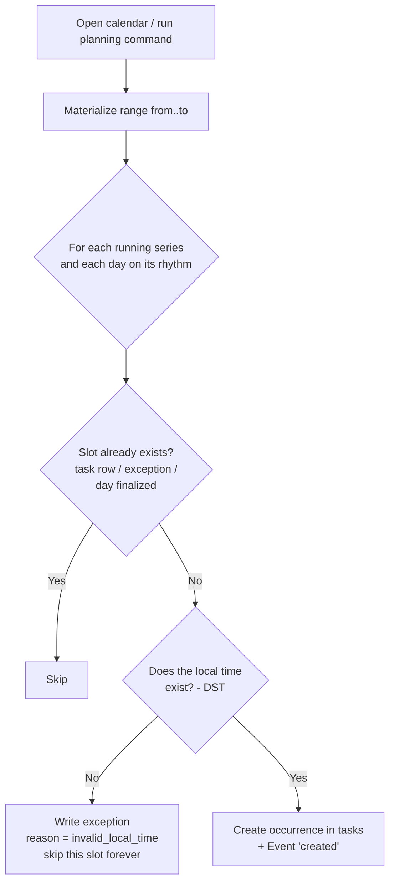
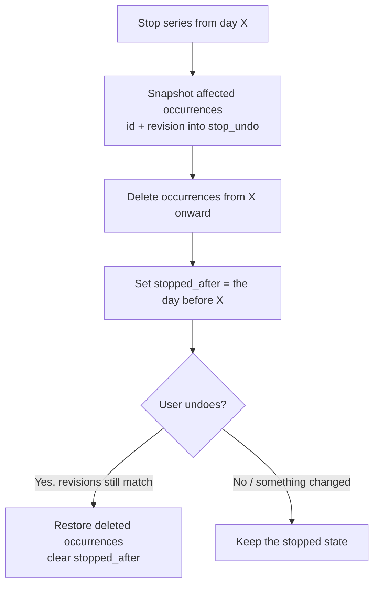

# 06 — Recurrence

## Purpose

Tasks repeating daily / every N days / weekly. The system does **not** pre-create occurrences forever: a series stores the template, and occurrences (ordinary rows in `tasks`) are generated lazily (materialized) when the calendar needs that date range.

## Data

| Table | Role |
|-------|------|
| `recurrence_series` | The template: `template` (JSON of the seed task), `start_date`, `cadence` (daily/interval/weekly), `interval_days` (1 / 7 / 2–365), `end_date`, `stopped_after`, `deadline_offset` + `deadline_time`, `schedule_offset_days`, `stop_undo`, `revision` |
| `tasks.series_id` + `tasks.original_occurrence_date` | Which series an occurrence belongs to and which original date it stands for; the pair is unique so an occurrence is never generated twice |
| `recurrence_exceptions` | A tombstone per slot (series, original date): blocks that slot from ever being regenerated |

## Materialize — lazy occurrence generation

Runs at the start of every planning command/query, over the requested range (at most 93 days). For each day matching a series' rhythm, a slot counts as *already existing* — and is skipped — if any of these holds:

1. A `tasks` row exists for (series, original date) — **including soft-deleted rows**;
2. A `recurrence_exceptions` row exists for the slot;
3. That date already has a finalized snapshot (except for a series explicitly just created for historical dates).

## Exceptions (tombstones) — the three reasons

| Reason | Written when | Meaning |
|--------|--------------|---------|
| `deleted` | User deletes a single occurrence | It must not resurrect on the next materialize |
| `moved` | User edits that occurrence to another date | The occurrence lives on its new date (keeping series_id + original date); the old slot is sealed against a duplicate |
| `invalid_local_time` | Materialize itself writes it | The occurrence's time falls into a non-existent local time (DST gap) — the slot is skipped permanently |

Note the distinction: **stopping a series** does not use exceptions — it sets `stopped_after`, cutting off the whole tail of the series.

## Editing occurrences: "this" and "this and following"

- Edit one occurrence (this): the occurrence is detached into a standalone task (series_id cleared), and the original series records an exception for its slot.
- Edit from this occurrence onward (this and following): the old series is stopped the day before, a new series starts at the edited occurrence with the new template, and the tail is materialized again.
- Shifting the whole series by days: the series accumulates `schedule_offset_days` instead of rewriting every occurrence.

## Stop & undo stop

