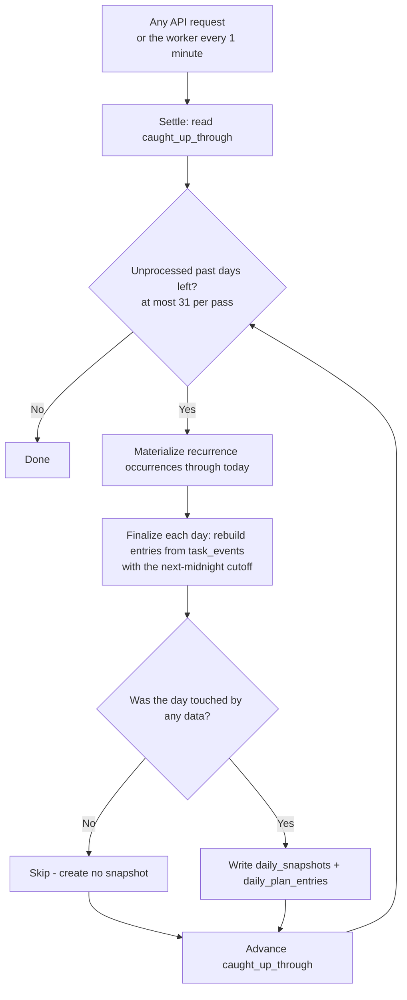
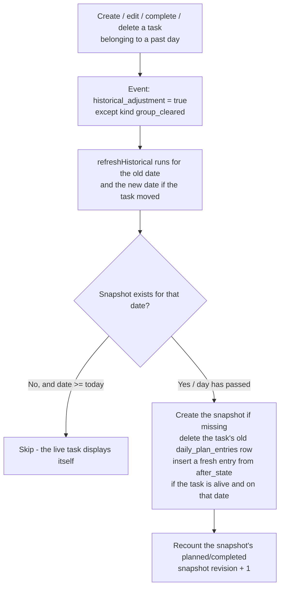

# 07 — Day Finalization & History Snapshots

## Purpose

Finalize each elapsed day into an **initial historical snapshot** of the plan and completion at that cutoff. Later unrelated operations must not silently rewrite it. However, a user can intentionally edit a past task: the controlled `historical_adjustment` path **does update the stored snapshot and historical percentages**. Therefore, the current snapshot is *not strictly immutable*; the immutable `task_events` journal records the adjustments.

## Data

| Table | Role |
|-------|------|
| `daily_snapshots` | One row per (user, date): `timezone` at finalization time, *current adjusted* `planned`/`completed`, `finalized_at`, `revision`. The first-finalized values are **not** retained in a separate immutable baseline column. |
| `daily_plan_entries` | The per-task detail of a snapshot: `task_state` is a frozen copy holding the full task plus `groupName` and `groupColor` as of finalization |
| `planning_state` | `caught_up_through`: the watermark — the last date Settle has fully processed for the user |

## Who reads from where

| Day type | Read source |
|----------|-------------|
| Past, has a snapshot | `daily_plan_entries` (with a few live fields patched in: revision, completedAt, focus progress, recurrence info) |
| Past, no snapshot | Returns `finalized: true` with **empty** entries (never falls back to `tasks`) |
| Today & future | Read live from `tasks` (`deleted_at IS NULL`) |

## Settle & Finalize

`Settle()` runs in two places: (1) at the start of every API transaction of that user; (2) in a background worker process that sweeps all accounts every 1 minute. Each Settle pass processes at most 31 days starting after `caught_up_through`, then advances the watermark.

Finalizing a day:
1. The cutoff is local midnight at the start of the next day.
2. Entries are rebuilt from `task_events`: for each task, take the latest `after_state` before the cutoff, *or* any event flagged `historical_adjustment`; drop `deleted` events.
3. If the day was completely untouched (no event touches it, no exception) **no snapshot is created** — that day returns empty entries forever.
4. Write `daily_snapshots` plus one `daily_plan_entries` row per entry.

## Historical adjustment — editing a finalized day

> Lesson from the 2026-10-26 "ghost task" bug: if a delete lands exactly in the window where "the date has no snapshot yet and the date is >= today", `refreshHistorical` skips it — but Finalize later rebuilds an entry from `task_events` that nobody removes, so the deleted task keeps appearing on the calendar even though `tasks.deleted_at` is set. Incident fix: delete the matching row from `daily_plan_entries` and recount the snapshot.

## Historical baseline versus adjustments

- **Initially finalized:** the entries and totals represent the accepted plan at local-day cutoff.
- **Unrelated later edits:** must not rewrite that date automatically. Group deletion is an explicit non-adjusting exception; saved group presentation remains as captured.
- **User-initiated backdated edit / completion / deletion / restore:** `Event` flags relevant old dates and `refreshHistorical` updates affected per-task entries and recounts `planned`/`completed`. Snapshot `revision` increases; historical reports can change.
- **Auditability:** `task_events` keeps full before/after states. It supports examining how a historical result changed but **does not** mean the original finalized `daily_snapshots` row is still available as an immutable baseline.
- **Future enhancement, not implemented:** if the product must display both "Original finalized" and "Adjusted" metrics, store immutable baseline/version records and show the adjustment reason and actor. Do not claim that distinction exists today.
- **Catch-up:** `Settle` processes up to 31 days per transaction. `WithTx` may commit one or more catch-up batches before the final transaction running a command; do **not** describe all catch-up work for an inactive account as part of one giant atomic transaction.

Acceptance: after an explicit old-day edit, daily totals, week/month rollups, and journal agree; deleting a group alone leaves past totals and captured presentation intact. See [analytics](09-analytics.md).
