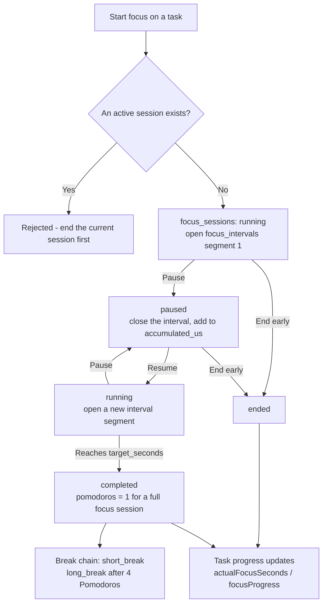

# 08 — Pomodoro / Focus

## Purpose

An optional, account-wide Pomodoro timer: focus sessions attach to a task (or run free), alternate with short/long breaks, and actual focused time accumulates into each task's progress.

## Data

| Table | Role |
|-------|------|
| `focus_sessions` | One session: `task_id` + `task_title` (copied so history survives task deletion), `kind` (focus/short_break/long_break), `status` (running/paused/completed/ended), `target_seconds`, `accumulated_us` (active microseconds accumulated), `running_since`, `started_at`, `ended_at`, `pomodoros` (0/1), `revision`, `sequence` (monotonic order used to find the latest session) |
| `focus_intervals` | The actual run segments inside a session — each pause/resume opens a new segment (`ordinal`, `started_at`, `ended_at`) |
| `settings` | Default durations: focus 25 min, short break 5 min, long break 15 min; a task can override with `tasks.focus_minutes` (1–180) |

## Key rules

- **At most one active session** (running or paused) per user at any moment — enforced by a partial unique index in the database, not just in code.
- The clock is *server-authoritative*: elapsed time is computed on the server from `running_since`/`accumulated_us`; clients only render and send start/pause/resume/end commands. `accumulated_us` never exceeds `target_seconds`.
- A running session **logically reaches its target** at the server-computed end instant; the persisted row becomes `completed` when a later focus-settlement path runs (for example, `GET /focus` / `Active` or a focus command). A fully completed focus session earns `pomodoros = 1`. The current planning sweeper is **not** a guaranteed background Focus completion scheduler.
- A task's progress is computed at query time from its focus sessions: `actualFocusSeconds` = total `accumulated_us`; `focusProgress` = ratio against the target duration (counting completed/ended sessions).
- Quick focus from the calendar: the event's quick-start control can start a task-bound session directly; opening the task panel and starting there is another path. If another session is active, offer that timer instead of starting a second session.

## Session lifecycle

## Completion, progress, and notifications

- A completed Pomodoro belongs to the account-local day on which the **session started**, including sessions paused/resumed across midnight or ending exactly at midnight. Active focus seconds remain split across the days when time was actually spent. Counts are awarded only after completion, including back-credit to a previous week/month. Historical comparisons respect their as-of cutoff.
- Ending early records actual focus time but does not earn a completed Pomodoro. Paused time and break sessions never count toward task focus duration; a completed Pomodoro does **not** auto-complete the task.
- The server is authoritative for focus timestamps, including after reload, sleep, or cross-device access. A client countdown estimates remaining time from the most recently fetched session state; it must not mutate the database or infer task completion on its own.
- After the server confirms that a session completed, clients must invalidate/refetch task, calendar and analytics views that derive focus totals. A stale old task view must not subtract the completed session when the active timer disappears.
- **Current notification behavior:** the web client can show a browser notification/sound when an observed active session transitions to completed, subject to permission and an active client. This is **not Web Push** and does not reliably notify when every app tab is closed.
- The worker and authenticated scheduled-job endpoint persist expired Focus completion without a browser read. Cloudflare cron configuration invokes this endpoint; API catch-up remains a fallback. [Web Push](12-pwa-notifications.md) requires deployed scheduler/VAPID configuration and explicit device opt-in. Local tests do not verify live closed-browser delivery.

## Acceptance checks

1. A 25-minute session ended after 10 minutes records roughly 10 minutes and zero completed Pomodoros.
2. Pausing/resuming or opening a second panel/device does not double-count time or drift a newly mounted clock back to the initial duration.
3. A session past its target is settled at the logical end time on the next relevant server read/command, with one Pomodoro only.
4. Upon server-confirmed completion, the task, calendar and report caches refresh; the task remains incomplete until the user completes it.

## Completion sounds

Settings → Timer sound provides eight original synthesized cues: Classic (the default), Bell, Soft bell, Double bell, Singing bowl, Doorbell, Gentle chime, and Digital. Preview sound plays the selected draft before saving; Save settings syncs the choice to the account. Muting retains the selection. Older clients that omit `timerSound` preserve the saved choice; the migration defaults existing accounts to Classic.

The selected cue plays when an observed focus or break session completes while the app is open. Browser audio restrictions still apply: starting/resuming a timer enables its audio context. Web Push uses the platform notification sound and does not use these cues.

References: [Focus To-Do](https://focustodo.cn/) for focus completion reminders, [Pomofocus](https://pomofocus.io/) for selectable alarm sounds, and [Mixkit bell sounds](https://mixkit.co/free-sound-effects/bell/) for bell cue inspiration. All shipped cues are synthesized locally; no third-party audio recordings are copied or fetched.

Regression checks cover pause/resume across midnight, exact-midnight completion, Tokyo-local month boundaries, no count before completion, and account sound persistence/validation.
