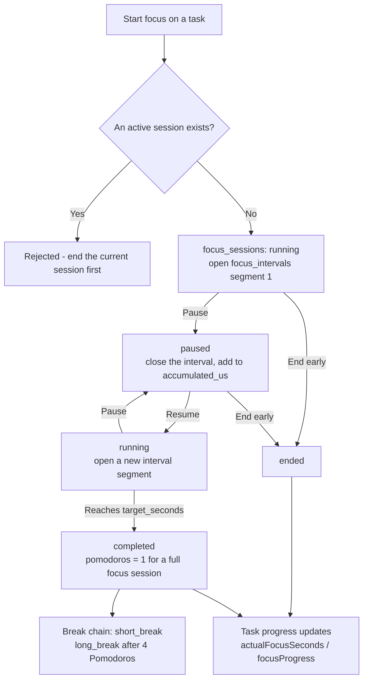

# 08 — Pomodoro / Focus

## Purpose

An optional, account-wide Pomodoro timer: focus sessions attach to a task (or run free), alternate with short/long breaks, and actual focused time accumulates into each task's progress.

## Data

| Table | Role |
|-------|------|
| `focus_sessions` | One session: `task_id` + `task_title` (copied so history survives task deletion), `kind` (focus/short_break/long_break), `status` (running/paused/completed/ended), `target_seconds`, `accumulated_us` (active microseconds accumulated), `running_since`, `started_at`, `ended_at`, `pomodoros` (0/1), `revision`, `sequence` (monotonic order used to find the latest session) |
| `focus_intervals` | The actual run segments inside a session — each pause/resume opens a new segment (`ordinal`, `started_at`, `ended_at`) |
| `settings` | Default durations: focus 25 min, short break 5 min, long break 15 min; a task can override with `tasks.focus_minutes` (1–180) |

## Key rules

- **At most one active session** (running or paused) per user at any moment — enforced by a partial unique index in the database, not just in code.
- The clock is *server-authoritative*: elapsed time is computed on the server from `running_since`/`accumulated_us`; clients only render and send start/pause/resume/end commands. `accumulated_us` never exceeds `target_seconds`.
- When the timer runs out, the session becomes `completed`, and a fully completed focus session earns `pomodoros = 1`.
- A task's progress is computed at query time from its focus sessions: `actualFocusSeconds` = total `accumulated_us`; `focusProgress` = ratio against the target duration (counting completed/ended sessions).
- Quick focus from the calendar: click an event → open the task panel → start a session bound to that task.

## Session lifecycle

