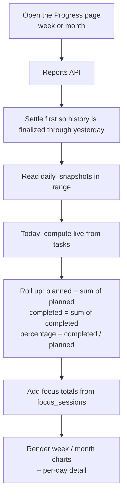

# 09 — Analytics

## Purpose

The Progress page: completion rates per day, rolled up to weeks and months, plus total focused time. Historical numbers stay stable against **unrelated** later edits, but **explicit historical adjustments** can revise finalized-day snapshots and report percentages (doc 07).

## Data sources

| Range | Source |
|-------|--------|
| Finalized days | `daily_snapshots` (planned/completed) |
| Today | Computed live from today's `tasks` |
| Focus | Summed from `focus_sessions` (kind = focus) |

## Key rules

- A day's percentage is `completed / planned` when `planned > 0`. With `planned = 0` the API returns **`null`** and UI displays **No plan**, not `0%`; `planned > 0, completed = 0` displays `0%`.
- Week/month rollups sum `planned` and `completed` across the member days first, then compute the percentage (never an average of percentages).
- Untouched past days (no snapshot) contribute 0/0 — they do not inflate the denominator.
- A historical adjustment (editing a task on a finalized day) updates the snapshot, so statistics re-align automatically; deleting a group does **not** change historical statistics because the `group_cleared` event never touches snapshots.

## Flow

## Metric boundaries and consistency

- Week/month completion is a weighted ratio of **summed** completed/planned counts, not the arithmetic mean of daily percentages. Days with no snapshot contribute `0/0`; future dates are not included in an in-progress period's completion totals.
- Task completion counts and scheduled-plan completion are separate metrics: completing an unscheduled task can increase the completed-task metric without changing a daily-plan denominator.
- Focus time comes from focus-session intervals, split at account-local day boundaries; a completed Pomodoro is attributed to the account-local day on which the session started (including completion at or after midnight), once completed; historical comparisons only include completion within their as-of cutoff. Live focus totals may change as sessions settle even when a finalized plan's contents remain stable.
- Explain in UI when a historical adjustment has changed a past daily percentage; otherwise users may mistake the initial finalization for a permanently immutable report.

Acceptance: `0 planned` = `No plan`; `0/5` = `0%`; `1/1 + 0/9` yields `10%` for the combined period; historical edits recalculate daily and period totals consistently.
