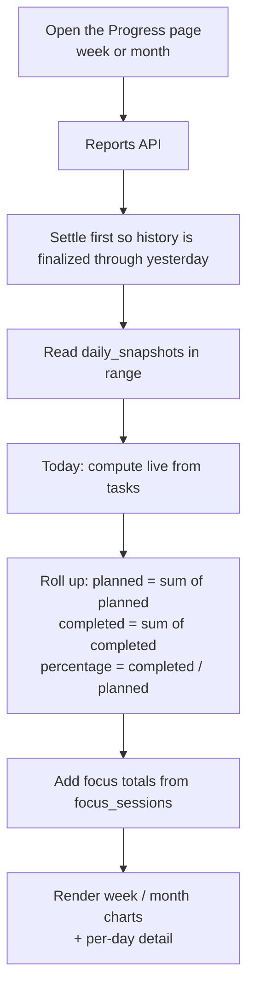

# 09 — Analytics

## Purpose

The Progress page: completion rates per day, rolled up to weeks and months, plus total focused time. Historical numbers must be *stable over time* — this is the reason the finalization system exists (doc 07).

## Data sources

| Range | Source |
|-------|--------|
| Finalized days | `daily_snapshots` (planned/completed) |
| Today | Computed live from today's `tasks` |
| Focus | Summed from `focus_sessions` (kind = focus) |

## Key rules

- A day's percentage is `completed / planned` (a day with planned = 0 yields 0%).
- Week/month rollups sum `planned` and `completed` across the member days first, then compute the percentage (never an average of percentages).
- Untouched past days (no snapshot) contribute 0/0 — they do not inflate the denominator.
- A historical adjustment (editing a task on a finalized day) updates the snapshot, so statistics re-align automatically; deleting a group does **not** change historical statistics because the `group_cleared` event never touches snapshots.

## Flow

