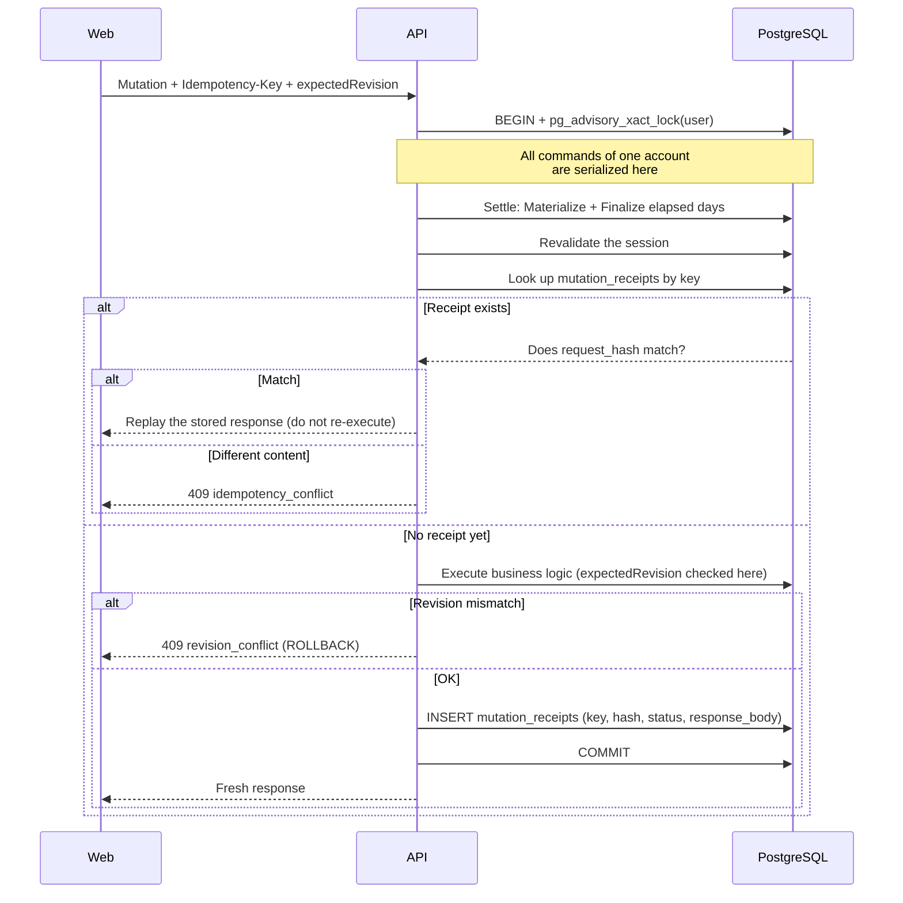

# 10 — Command Pipeline: Idempotency & Concurrency

## Purpose

Prevent a **successfully receipted** write from being re-executed when the same account retries with the same Idempotency-Key and identical request payload; reject revision conflicts; and run business logic after required history settlement. Every other feature (tasks, groups, series, focus…) uses this pipeline.

## Two different mechanisms — do not confuse them

| | `revision` (+ `expectedRevision`) | `mutation_receipts` (Idempotency-Key) |
|--|-----------------------------------|----------------------------------------|
| Question it answers | "Has the data changed since I read it?" | "Has this exact request already been processed?" |
| Scope | Each data row (task, group, series, settings, focus session, snapshot…) | Each write request of a user |
| On conflict | 409 `revision_conflict` — "This item changed. Refresh and try again." | Replays the stored response if the content is identical; 409 `idempotency_conflict` if the same key carries different content |
| Protects against | Two sessions/tabs/devices editing from a stale read | Flaky networks, client retries, double clicks |

## Pipeline of one mutation — `Execute` / `WithTx`

## Notes

- The per-user advisory lock serializes commands within one account; different accounts still run fully in parallel.
- `Settle` runs *before* business logic. `WithTx` may **commit separate 31-day catch-up batches** and retry until settled, then run the user command + its idempotency receipt together in the final transaction. Thus a failed command does not necessarily roll back earlier successful history catch-up batches.
- The receipt is written **in the same transaction** as the business change: either both commit or neither does — there is no state of "executed but no receipt".
- Reads go through `View`: they take the per-account lock and run Settle without receipts. Authentication occurs at the request boundary; unlike `Execute`, `View` does **not** itself call `ValidateOwnedSession` inside its transaction. A separate requirement would be needed for strict in-transaction revocation checks on reads.

## Retry and test contract

- The idempotency key is scoped to the **account**. Reuse the same key and identical request bytes for an uncertain retry; using the same key with different input returns 409.
- A successful write and its receipt share the **same** commit. A conflict/error before that commit does not create a successful receipt.
- An account lock serializes transactions, but `Settle` may need multiple bounded transactions to catch up after inactivity.
- Integration tests should cover concurrent retries with one key, same-key/different-body 409, stale `expectedRevision`, session revoked before mutation, and rollback before receipt insert.
