# 10 — Command Pipeline: Idempotency & Concurrency

## Purpose

Guarantee that every write command (mutation) in TodoCal never executes twice on a client retry, never overwrites data that changed underneath it, and always runs on top of fully settled history. Every other feature (tasks, groups, series, focus…) runs inside this frame.

## Two different mechanisms — do not confuse them

| | `revision` (+ `expectedRevision`) | `mutation_receipts` (Idempotency-Key) |
|--|-----------------------------------|----------------------------------------|
| Question it answers | "Has the data changed since I read it?" | "Has this exact request already been processed?" |
| Scope | Each data row (task, group, series, settings, focus session, snapshot…) | Each write request of a user |
| On conflict | 409 `revision_conflict` — "This item changed. Refresh and try again." | Replays the stored response if the content is identical; 409 `idempotency_conflict` if the same key carries different content |
| Protects against | Two sessions/tabs/devices editing from a stale read | Flaky networks, client retries, double clicks |

## Pipeline of one mutation — `Execute` / `WithTx`

```mermaid
sequenceDiagram
    participant W as Web
    participant A as API
    participant DB as PostgreSQL
    W->>A: Mutation + Idempotency-Key + expectedRevision
    A->>DB: BEGIN + pg_advisory_xact_lock(user)
    Note over A,DB: All commands of one account<br/>are serialized here
    A->>DB: Settle: Materialize + Finalize elapsed days
    A->>DB: Revalidate the session
    A->>DB: Look up mutation_receipts by key
    alt Receipt exists
        DB-->>A: Does request_hash match?
        alt Match
            A-->>W: Replay the stored response (do not re-execute)
        else Different content
            A-->>W: 409 idempotency_conflict
        end
    else No receipt yet
        A->>DB: Execute business logic (expectedRevision checked here)
        alt Revision mismatch
            A-->>W: 409 revision_conflict (ROLLBACK)
        else OK
            A->>DB: INSERT mutation_receipts (key, hash, status, response_body)
            A->>DB: COMMIT
            A-->>W: Fresh response
        end
    end
```

## Notes

- The per-user advisory lock serializes commands within one account; different accounts still run fully in parallel.
- `Settle` runs *before* the business logic so a command always sees finalized history — e.g. creating a backdated task finds that day's snapshot already in place.
- The receipt is written **in the same transaction** as the business change: either both commit or neither does — there is no state of "executed but no receipt".
- Reads go through `View`: they still take the lock and run Settle, but have no receipt (the session is still revalidated).
