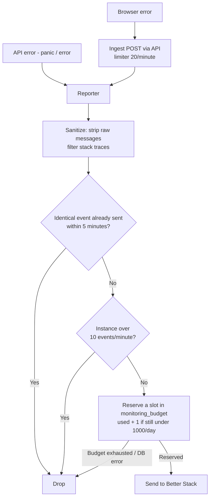

# 11 — Error Monitoring

## Purpose

Send API and browser errors to Better Stack (Sentry protocol) for production visibility — but in a disciplined way: scrubbed of sensitive content, deduplicated, and capped by a hard daily budget so an infinitely repeating error cannot burn the whole quota.

## Data

| Table | Role |
|-------|------|
| `monitoring_budget` | Exactly one row system-wide (`singleton = true`): `day`, `used` — how many events have been consumed today |

## Defense layers (outside in)

1. **Browser error ingest endpoint**: at most 20 requests/minute, body capped at 32 KiB, at most 3 exceptions per payload.
2. **Inside each instance**: identical events are deduplicated within 5 minutes (by content hash), at most 10 events/minute, queue capped at 16.
3. **Shared database budget**: at most **1000 events/day** (`DailyLimit`) across *all* instances and both sources (API + browser). Every event must atomically reserve a slot in `monitoring_budget` before being sent — the counter resets on a new day. **Fail-closed**: if the reservation fails, nothing is sent.

## Scrubbing before send

- Error messages are replaced with a generic string ("Error details removed for privacy") — raw error text is never sent.
- Stack traces keep only the file basename, validated function names, and line numbers; at most 30 frames and 3 exceptions.
- Browser frames are kept only if they belong to `/_next/static/`.

## Flow

