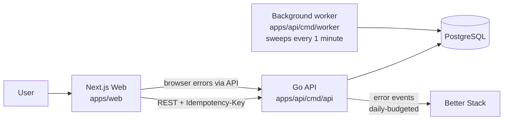

# TodoCal — Feature Documentation

This documentation set describes each TodoCal feature: its purpose, core concepts, related data, and flow diagrams (Mermaid — rendered directly on GitHub).

| # | Feature | File |
|---|---------|------|
| 01 | Accounts & authentication | [01-accounts-auth.md](01-accounts-auth.md) |
| 02 | Task management | [02-tasks.md](02-tasks.md) |
| 03 | Groups | [03-groups.md](03-groups.md) |
| 04 | Calendar & display | [04-calendar-display.md](04-calendar-display.md) |
| 05 | Drag-and-drop scheduling & schedule undo | [05-schedule-undo.md](05-schedule-undo.md) |
| 06 | Recurrence | [06-recurrence.md](06-recurrence.md) |
| 07 | Day finalization & history snapshots | [07-planning-finalization.md](07-planning-finalization.md) |
| 08 | Pomodoro / Focus | [08-pomodoro-focus.md](08-pomodoro-focus.md) |
| 09 | Analytics | [09-analytics.md](09-analytics.md) |
| 10 | Command pipeline: idempotency & concurrency | [10-command-pipeline.md](10-command-pipeline.md) |
| 11 | Error monitoring | [11-monitoring.md](11-monitoring.md) |
| 12 | PWA & notification scope | [12-pwa-notifications.md](12-pwa-notifications.md) |
| 13 | Settings and personalization | [13-settings.md](13-settings.md) |
| 14 | UX & accessibility | [14-ux-accessibility.md](14-ux-accessibility.md) |
| 15 | Cross-feature acceptance scenarios | [15-acceptance-scenarios.md](15-acceptance-scenarios.md) |
| 16 | Proposed code changes & implementation backlog | [16-implementation-backlog.md](16-implementation-backlog.md) |

## Overall architecture

TodoCal consists of three processes: the web app (Next.js), the API (Go REST), and a background worker (Go). All data operations go through the API; the web app never touches PostgreSQL directly.

## Cross-cutting principles

- **The server is the single source of truth**: clients only render and send commands; all validation, finalization, and occurrence generation happen on the server.
- **Every write command runs in one per-account transaction** (`WithTx`): advisory lock per user → `Settle` (finalize elapsed days) → idempotency receipt check → execute → store receipt. See [10-command-pipeline.md](10-command-pipeline.md).
- **Optimistic concurrency**: every entity carries a `revision`; clients send `expectedRevision`, and a mismatch returns 409.
- **Past days are read from snapshots**; today and future days are read from live tables. A finalized snapshot can still be adjusted by an explicit historical command, and original finalized values are not retained as a separate immutable baseline. See [07-planning-finalization.md](07-planning-finalization.md).

## Documentation contract

- Documents **01–11** describe the current implementation, including verified limitations. Documents **12–16** distinguish **Current** behavior from **Proposed** work; acceptance scenarios may be pending implementation.
- These files are maintained with code changes. If product terminology or UI behavior changes, update the affected feature docs and acceptance examples in the same PR.
- **Known design boundaries:** `This and following` edit/**delete** is the **approved proposal**, not the current code. Today's `All occurrences` edit affects eligible occurrences from today forward, whereas Stop Repeating cuts off after today. The implementation plan is in [16-implementation-backlog.md](16-implementation-backlog.md). A 10-second schedule undo is server-enforced, whereas delete/series recovery has a 10-second UI toast without equivalent backend expiration.
- Installable PWA metadata currently exists, but background Web Push, offline editing, and automated scheduled Focus reminders are not yet promised. See [12-pwa-notifications.md](12-pwa-notifications.md).
