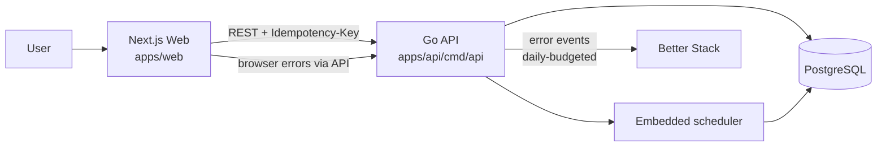

# TodoCal — Feature Documentation

This documentation set describes each TodoCal feature: its purpose, core concepts, related data, and flow diagrams (Mermaid — rendered directly on GitHub).

| # | Feature | File |
|---|---------|------|
| 01 | Accounts & authentication | [01-accounts-auth.md](01-accounts-auth.md) |
| 02 | Task management | [02-tasks.md](02-tasks.md) |
| 03 | Groups | [03-groups.md](03-groups.md) |
| 04 | Calendar & display | [04-calendar-display.md](04-calendar-display.md) |
| 05 | Drag-and-drop scheduling & schedule undo | [05-schedule-undo.md](05-schedule-undo.md) |
| 06 | Recurrence | [06-recurrence.md](06-recurrence.md) |
| 07 | Day finalization & history snapshots | [07-planning-finalization.md](07-planning-finalization.md) |
| 08 | Pomodoro / Focus | [08-pomodoro-focus.md](08-pomodoro-focus.md) |
| 09 | Analytics | [09-analytics.md](09-analytics.md) |
| 10 | Command pipeline: idempotency & concurrency | [10-command-pipeline.md](10-command-pipeline.md) |
| 11 | Error monitoring | [11-monitoring.md](11-monitoring.md) |
| 12 | PWA & notification scope | [12-pwa-notifications.md](12-pwa-notifications.md) |
| 13 | Settings and personalization | [13-settings.md](13-settings.md) |
| 14 | UX & accessibility | [14-ux-accessibility.md](14-ux-accessibility.md) |
| 15 | Cross-feature acceptance scenarios | [15-acceptance-scenarios.md](15-acceptance-scenarios.md) |
| 16 | Proposed code changes & implementation backlog | [16-implementation-backlog.md](16-implementation-backlog.md) |

## Overall architecture

TodoCal serves the Next.js web app through Cloudflare and runs a Go API with an embedded notification scheduler. There is no standalone worker process. All web data operations go through the API; the web app never touches PostgreSQL directly. See [scheduler architecture](../architecture/notificationScheduler.md).

## Cross-cutting principles

- **The server is the single source of truth**: clients only render and send commands; all validation, finalization, and occurrence generation happen on the server.
- **Every write command runs in one per-account transaction** (`WithTx`): account settings-row lock → `Settle` (finalize elapsed days) → idempotency receipt check → execute → store receipt. Catch-up may commit bounded batches before the final command transaction. See [10-command-pipeline.md](10-command-pipeline.md).
- **Optimistic concurrency**: every entity carries a `revision`; clients send `expectedRevision`, and a mismatch returns 409.
- **Past days are read from snapshots**; today and future days are read from live tables. A finalized snapshot can still be adjusted by an explicit historical command, and original finalized values are not retained as a separate immutable baseline. See [07-planning-finalization.md](07-planning-finalization.md).

## Documentation contract

- Feature documents describe implemented behavior and explicitly label exclusions or future work. Acceptance/backlog records retain historical test evidence; implementation status is separate from live-provider verification.
- These files are maintained with code changes. If product terminology or UI behavior changes, update the affected feature docs and acceptance examples in the same PR.
- **Recurrence scopes:** `This and following` edit/delete is implemented; see [recurrence](06-recurrence.md) and the implementation record in [16-implementation-backlog.md](16-implementation-backlog.md). A 10-second schedule undo is server-enforced, whereas delete/series recovery has a 10-second UI toast without equivalent backend expiration.
- PWA installation, Web Push and scheduled Focus settlement are implemented. Delivery requires a running API, VAPID configuration and device permission; offline editing is not supported. See [12-pwa-notifications.md](12-pwa-notifications.md).

Scope decision (2026-11-01): Trash / Recently Deleted and a separate immutable historical baseline are excluded. Existing Undo/restore and adjusted snapshots remain; see [backlog](16-implementation-backlog.md).
