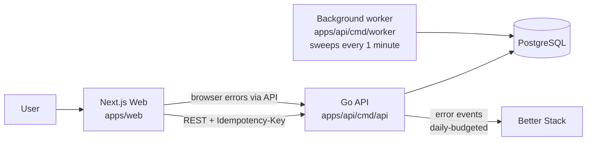

# TodoCal — Feature Documentation

This documentation set describes each TodoCal feature: its purpose, core concepts, related data, and flow diagrams (Mermaid — rendered directly on GitHub).

| # | Feature | File |
|---|---------|------|
| 01 | Accounts & authentication | [01-accounts-auth.md](01-accounts-auth.md) |
| 02 | Task management | [02-tasks.md](02-tasks.md) |
| 03 | Groups | [03-groups.md](03-groups.md) |
| 04 | Calendar & display | [04-calendar-display.md](04-calendar-display.md) |
| 05 | Drag-and-drop scheduling & schedule undo | [05-schedule-undo.md](05-schedule-undo.md) |
| 06 | Recurrence | [06-recurrence.md](06-recurrence.md) |
| 07 | Day finalization & history snapshots | [07-planning-finalization.md](07-planning-finalization.md) |
| 08 | Pomodoro / Focus | [08-pomodoro-focus.md](08-pomodoro-focus.md) |
| 09 | Analytics | [09-analytics.md](09-analytics.md) |
| 10 | Command pipeline: idempotency & concurrency | [10-command-pipeline.md](10-command-pipeline.md) |
| 11 | Error monitoring | [11-monitoring.md](11-monitoring.md) |

## Overall architecture

TodoCal consists of three processes: the web app (Next.js), the API (Go REST), and a background worker (Go). All data operations go through the API; the web app never touches PostgreSQL directly.

## Cross-cutting principles

- **The server is the single source of truth**: clients only render and send commands; all validation, finalization, and occurrence generation happen on the server.
- **Every write command runs in one per-account transaction** (`WithTx`): advisory lock per user → `Settle` (finalize elapsed days) → idempotency receipt check → execute → store receipt. See [10-command-pipeline.md](10-command-pipeline.md).
- **Optimistic concurrency**: every entity carries a `revision`; clients send `expectedRevision`, and a mismatch returns 409.
- **Past days are read from snapshots**; today and future days are read from the live tables. See [07-planning-finalization.md](07-planning-finalization.md).
